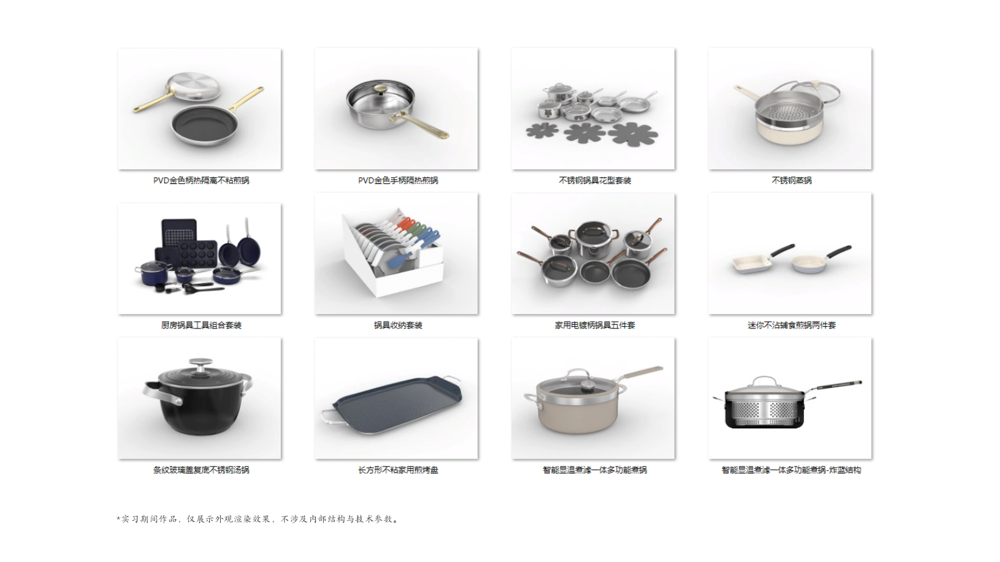
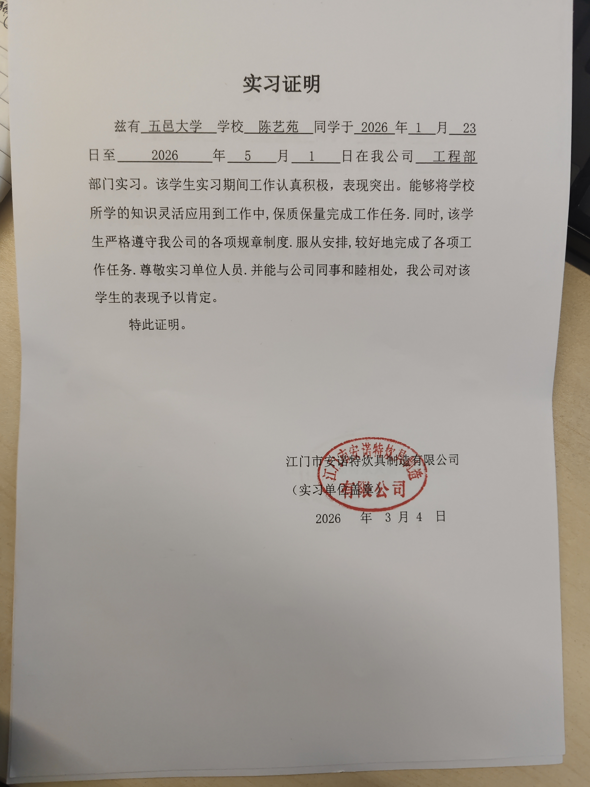

# 实习笔记
> 江门市安诺特炊具制造有限公司
> 姓名：陈艺苑｜专业：电子信息工程｜实习岗位：工程部
> 标语：**专业立身，态度成事**

## 实习计划

|      | 初期 | 中期 | 后期 |
| ---- | ---- | ---- | ---- |
| 1. 建模 | 产品参数 | 复杂建模 | 改善方法，提升效率 |
| 2. 渲染 | 基础视频操作 | 细节优化 | 快速理解需求 |
| 3. PS | 摸索操作 | 边做边学 | 丰富操作能力 |
| 4. 额外收获 | 理解产品、工作需求，高效合作，项目规范化 | 理解产品、工作需求，高效合作，项目规范化 | 理解产品、工作需求，高效合作，项目规范化 |

## 前言
本次实习笔记记录了实习内容、工作心得与个人反思，是对本次实习的全面梳理与总结。

## 目录
- [一、实习目的](#一实习目的)
- [二、公司性质](#二公司特点)
- [三、工作性质](#三工作特点)
- [四、实习内容汇总](#四实习内容汇总)
- [五、实习总结](#五实习总结)

## 一、 实习目的
1. 将课堂所学的工程制图、材料工艺知识应用于真实产品开发
2. 了解制造业产品从设计到量产的完整流程
3. 提升跨部门协作与英文技术文档阅读能力
4. 明确自身职业方向，为就业做准备

## 二、 公司特点
1. 比利时CWC集团旗下，全球西式高端炊具头部企业，客户以欧美市场为主
2. 福利体系成熟，注重员工稳定发展
3. 秉持“先德后才”理念，重视环保与合规
4. 重视产品创新与工艺改进，技术积累深厚

## 三、 工作特点
1. 以SolidWorks建模、工程图输出、DFM评审为核心工作内容
2. 团队氛围友善，跨部门协作顺畅
3. 参与真实量产项目，参数化建模效率提升30%
4. 在成熟工艺基础上做优化创新，而非从零发明

## 四、 实习内容汇总
### (一) 生产工序
1. 精轧，冲压：锻压
2. 车变，使均匀
3. 口部毛边处理
4. 锅底毛刺
5. 冲孔
6. 压底凹，使平稳
7. 喷涂准备：提升粗糙
8. 提高抗磨
9. 电磁感应金属层：金属热贴附
10. 提高平滑度
11. 不含PFOA内喷涂：传热耐高温
12. 美观去污性外喷
13. 印商标
14. 安装侧耳手柄
15. 冲压盖耳打孔
16. 手工打磨，侧耳弯角
17. 玻璃盖:不锈钢钢圈
18. 铸件手柄，模壳，打磨抛光清洗
19. STP彩盒，彩色纸盒
20. 炊具检测实验

### (二) 主要材料/技术
1. 镜面不锈钢
2. 马氏不锈钢
3. SS304/ALU1050/SS430
4. ALU
5. 喷漆涂层
6. 铝合金
7. 塑料餐具
8. PVD

### (三) 建模任务
1. 锅型：
    - a) 底部类型：渐变层（画平底后续改）
    - b) 锅边类型：L型（画最外层），圆弧切除型
    - c) 锅身：方盘，斜口锅
    - d) 纹理类型
2. 配件：
    - a) 手柄
    - b) 把手
    - c) 盖柄
    - d) 锅铲

## 五、 实习总结
### 1. 主要职责
① **三维建模与工程图输出**
- 负责炊具产品SolidWorks建模、装配及2D工程图绘制，优化装配关系，减少干涉。
- 跟进图纸审核，配合完成钣金/冲压DFM评审，确保图纸可制造性。

② **参数化建模方法优化**
- 独立总结倾倒口结构的参数化建模方法，建模效率提升30%，并在团队内分享。

③ **设计数据管理与合规验证**
- 协助建立图纸与技术文档管理系统，完成BOM搭建与归档。
- 查阅英文技术标准与规范文档，辅助完成工艺与材料合规验证。

④ **产品可视化支持**
- 输出白底/背面细节图，用于工艺评审、模具对接与表面处理方案优化。

### 2. 综合评分

| 评分维度 | 得分 | 评分依据 |
| ---- | ---- | ---- |
| 工作完成度 | 90 | 独立完成建模、出图、DFM评审等核心任务，无重大返工 |
| 工作质量 | 88 | 图纸规范、公差合理，参数化建模方法被团队采纳 |
| 学习能力 | 92 | 快速上手SolidWorks/Creo，4个月内掌握DFM评审标准 |
| 团队协作 | 90 | 跨部门沟通顺畅，主动分享建模方法，获得同事认可 |
| 主动性 | 88 | 主动总结参数化方法并分享，主动查阅英文标准 |
| 综合评分 | 90 | 优秀 |

 

## 📌返回导航
[⬅ 返回作品集首页](../../README.md)