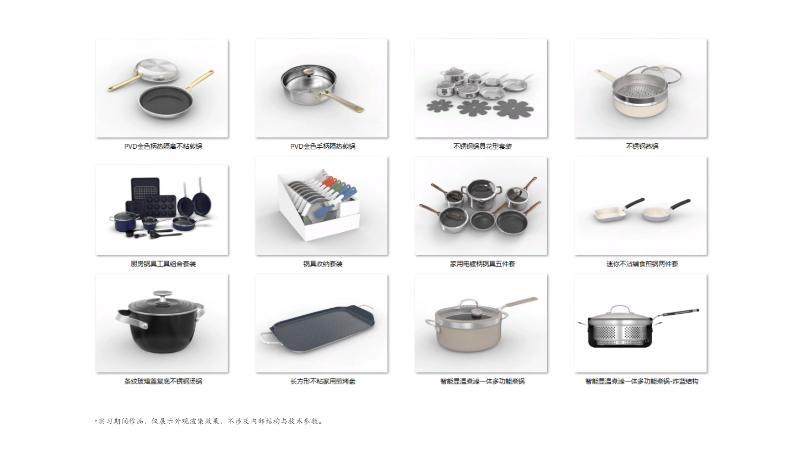
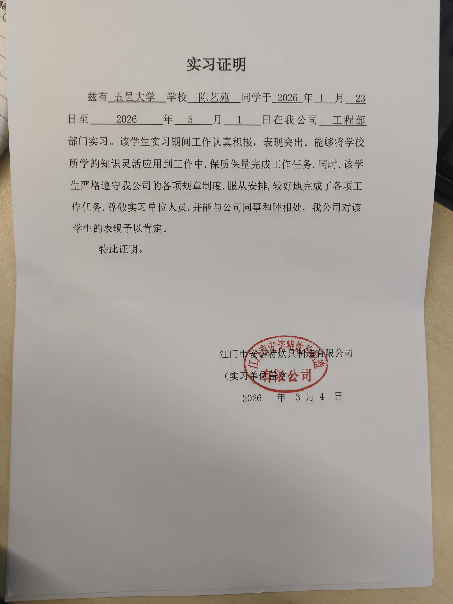

# 实习笔记
> 江门市安诺特炊具制造有限公司
> 姓名：陈艺苑｜专业：电子信息工程｜实习岗位：工程部
> 标语：**专业立身，态度成事**

## 实习计划

|      | 初期 | 中期 | 后期 |
| ---- | ---- | ---- | ---- |
| 1. 建模 | 产品参数 | 复杂建模 | 改善方法，提升效率 |
| 2. 渲染 | 基础视频操作 | 细节优化 | 快速理解需求 |
| 3. PS | 摸索操作 | 边做边学 | 丰富操作能力 |
| 4. 额外收获 | 理解产品、工作需求，高效合作，项目规范化 | 理解产品、工作需求，高效合作，项目规范化 | 理解产品、工作需求，高效合作，项目规范化 |

## 前言
本次实习笔记记录了实习内容、工作心得与个人反思，是对本次实习的全面梳理与总结。

## 目录
- [一、实习目的](#一实习目的)
- [二、公司性质](#二公司特点)
- [三、工作性质](#三工作特点)
- [四、实习内容汇总](#四实习内容汇总)
- [五、实习总结](#五实习总结)

## 一、实习背景与职业锚定
1.	在专注于底层固件与软件算法之前，深入全球头部制造企业（比利时CWC集团旗下高端炊具企业），补齐“物理硬件与量产制造”的认知短板。
2.	职业价值：打破纯软件开发的局限，明确“软硬协同”的嵌入式研发方向，为后续主导四足机器人、飞控及边缘网关等整机级项目打下物理实体认知基础。

## 二、	公司及工作背景
1.	比利时CWC集团旗下，全球西式高端炊具头部企业，客户以欧美市场为主
2.	以SolidWorks建模、工程图输出、DFM评审为核心工作内容
3.	参与真实量产项目，参数化建模效率提升30%
4.	在成熟工艺基础上做优化创新，而非从零发明
5.	秉持“先德后才”理念，重视环保与合规
6.	重视产品创新与工艺改进，技术积累深厚
## 三、	核心工作与技术产出
⒈三维建模与空间几何直觉（SolidWorks）
·工作产出：参与高端复杂曲面产品的结构建模与视觉渲染，输出标准工程图纸。
· 硬核迁移：在项目中深刻理解三维坐标系变换、空间几何约束与装配干涉。
· 效率优化：引入并优化参数化建模流程，使同类产品设计迭代效率提升 30%。
⒉DFM 可制造性评审与硬件落地
· 工作产出：主导产品结构的 DFM（可制造性）评审，提前规避注塑公差、装配干涉与量产风险。
· 硬核迁移：深刻理解“实验室原型”到“工厂量产”的鸿沟。将这种“量产可靠性思维”直接应用于后续嵌入式系统开发中（如：BMS板的PCB堆叠设计、温控系统的隔热腔体3D打印适配、国产芯片替代方案的整机联调）。
⒊跨部门协同与英文技术文档
· 工作产出：查阅并精准翻译欧美市场英文技术标准与合规文档，推动结构、模具、硬件与生产部门的技术对齐。
· 硬核迁移：锻炼了无障碍阅读英文 Datasheet、技术规范的能力；在复杂研发链路中，具备了与机械、硬件、测试团队高效沟通。
## 工程师思维沉淀
1. 制造约束思维：任何代码与硬件设计都必须在物理公差、材料特性与成本约束下运行。
2. 系统级工程观：理解了成熟工艺基础上的微创新。

## 四、 实习内容汇总
### (一) 生产工序
1. 精轧，冲压：锻压
2. 车变，使均匀
3. 口部毛边处理
4. 锅底毛刺
5. 冲孔
6. 压底凹，使平稳
7. 喷涂准备：提升粗糙
8. 提高抗磨
9. 电磁感应金属层：金属热贴附
10. 提高平滑度
11. 不含PFOA内喷涂：传热耐高温
12. 美观去污性外喷
13. 印商标
14. 安装侧耳手柄
15. 冲压盖耳打孔
16. 手工打磨，侧耳弯角
17. 玻璃盖:不锈钢钢圈
18. 铸件手柄，模壳，打磨抛光清洗
19. STP彩盒，彩色纸盒
20. 炊具检测实验

### (二) 主要材料/技术
1. 镜面不锈钢
2. 马氏不锈钢
3. SS304/ALU1050/SS430
4. ALU
5. 喷漆涂层
6. 铝合金
7. 塑料餐具
8. PVD

### (三) 建模任务
1. 锅型：
    - a) 底部类型：渐变层（画平底后续改）
    - b) 锅边类型：L型（画最外层），圆弧切除型
    - c) 锅身：方盘，斜口锅
    - d) 纹理类型
2. 配件：
    - a) 手柄
    - b) 把手
    - c) 盖柄
    - d) 锅铲

## 五、 实习总结
### 1. 主要职责
① **三维建模与工程图输出**
- 负责炊具产品SolidWorks建模、装配及2D工程图绘制，优化装配关系，减少干涉。
- 跟进图纸审核，配合完成钣金/冲压DFM评审，确保图纸可制造性。

② **参数化建模方法优化**
- 独立总结倾倒口结构的参数化建模方法，建模效率提升30%，并在团队内分享。

③ **设计数据管理与合规验证**
- 协助建立图纸与技术文档管理系统，完成BOM搭建与归档。
- 查阅英文技术标准与规范文档，辅助完成工艺与材料合规验证。

④ **产品可视化支持**
- 输出白底/背面细节图，用于工艺评审、模具对接与表面处理方案优化。

### 2. 综合评分

| 评分维度 | 得分 | 评分依据 |
| ---- | ---- | ---- |
| 工作完成度 | 90 | 独立完成建模、出图、DFM评审等核心任务，无重大返工 |
| 工作质量 | 88 | 图纸规范、公差合理，参数化建模方法被团队采纳 |
| 学习能力 | 92 | 快速上手SolidWorks/Creo，4个月内掌握DFM评审标准 |
| 团队协作 | 90 | 跨部门沟通顺畅，主动分享建模方法，获得同事认可 |
| 主动性 | 88 | 主动总结参数化方法并分享，主动查阅英文标准 |
| 综合评分 | 90 | 优秀 |

 

---

## 🏷 标识说明

**本项目标识：🟢 基础 / 跨方向** —— 产品结构设计实习，非固件方向；提供硬件制造工艺与跨部门协同视角。

**交付形态：📄 文档级** —— 本目录公开设计与调试文档，源码 / 原理图未纳入仓库。

| 标识 | 含义 |
|---|---|
| 🟢 | 基础：外设与协议基础验证，体现技术广度 |
| 📄 | 文档级交付：本目录仅有设计与调试文档，源码 / 原理图未纳入仓库 |

> 表格中只解释本文用到的标识；等级体系（👑 代表作 / 🔴 进阶 / 🟡 中等 / 🟢 基础 / 🚧 在研）与全部项目索引见 [作品集首页](../../README.md)。

## 📌返回导航
[⬅ 返回作品集首页](../../README.md)