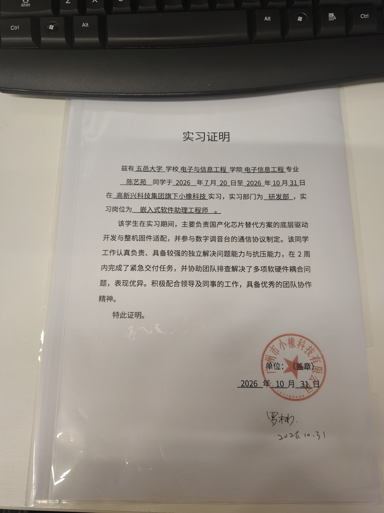

# 高新兴｜嵌入式软件助理工程师 实习工作内容总结
> 📌实习期间参与3个嵌入式DSP项目：**MH2030A八路电源时序器国产化、BP2668Ax数字调音台反馈抑制器、2×2桌面USB声卡**，兼顾固件开发、DSP预研、软硬件排错、技术文档输出。

## 1. MH2030A八路电源时序控制器｜国产RISC‑V芯片　`量产交付`
**项目目标：国产芯片替代进口电源时序器件，开发八路电源通道时序控制整机固件。**
- ✅ 软件架构：采用**非阻塞FSM有限状态机**，实现八路通道顺序上电、逆序下电完整时序逻辑，全程不使用阻塞延时；
- ✅ 业务功能：ADC矩阵按键解析、段码屏状态显示、HLW8032功率计量采集、Modbus‑RTU通信、IWDG独立看门狗、Flash参数掉电保存；
- ✅ BUG修复：解决上电接续异常、屏幕刷新闪烁、时序无效空延时等业务缺陷；完成整机联调测试，交付可投产固件；
- ✅ 调试排错：排查国产安全芯片J‑Link烧录保护、调试适配等软硬结合问题；完成Git版本归档，输出完整技术设计文档。

## 2. BP2668Ax 数字调音台‑反馈抑制器项目｜RISC‑V音频DSP　`阶段交付`
**项目目标：BP2668Ax音频DSP Bring‑up，预研FBX陷波+移频啸叫抑制功能，打通M20主控与DSP通信链路。**
- ✅ 平台Bring‑up：调试SDK LineIn音频回环Demo，熟悉I2S音频数据流，掌握音频路由`dsp_connector_neo`接口使用；
- ✅ 协议研究：研读M20‑DSPAPI自定义COBS‑CRC串口协议，梳理指令下发、ACK应答、电平/状态周期上报完整交互流程；
- ✅ 调试方案优化：定位UART0被I2S外设抢占，无法串口打印日志；搭建替代调试方案：JTAG监视全局变量、GPIO电平翻转、DSP报文上报；
- ✅ 文档沉淀：整理烧录、编译链接脚本踩坑记录，维护开发Checklist；受硬件底板物料限制，声学闭环啸叫实物验证待硬件到位开展。

## 3. 2×2桌面USB声卡｜BP2668Ax DSP　`方案设计`
**项目目标：完成桌面USB声卡整体方案，硬件未到货阶段完成全部上层业务框架，底层驱动预留空桩。**
- ✅ 方案设计：输出硬件选型、7阶段落地开发方案文档；
- ✅ 上层业务开发：实现长短按按键状态机；音频混音路由，**增益平滑渐变消除切换pop爆音**；设计`SystemState_t`全局单一数据源，统一管理整机业务状态；
- ✅ 模块化封装：完成`screen_task`屏幕任务、`relay_ctrl`继电器控制模块（底层硬件接口空桩预留），预留FBX/移频算法接入点位；
- ✅ 工程问题处理：解决IDE路径硬编码、文件重名冲突，工程可完整编译；SPI、Codec、USB音频芯片底层驱动待外设硬件到货后填充。

## 🛠 工程习惯与方法论
- **版本与文档**：Git进行版本管理，开发同步迭代设计文档，输出方案、流程图、踩坑复盘；
- **问题沉淀**：维护开发周报，完整记录故障现象‑根因‑排查‑修复方案；
- **任务管理**：维护开发Checklist，区分软件逻辑仿真验证、硬件实物测试，防止功能、测试点遗漏；
- **排错能力**：擅长处理烧录异常、编译报错、音频实时性、软硬耦合类疑难问题。

 

---

## 🏷 标识说明

> 本页只标**可核查的事实**（交付形态）；主观难度自评只在各项目页末尾出现，不在此处重复。

| 标识 | 含义 | 出现位置 |
|---|---|---|
| 👑 | 母题代表作：作者优先讲解，同一母题给出多套架构取舍 | 索引 / 项目页 |
| ⭐ | 该岗位方向建议优先阅读 | 首页岗位索引 |
| 🚧 | 在研 / 预研：方案与验证路线已完成，无交付物与实测数据 | 全站 |
| `量产交付` | 已随产品出货并通过产线验证，公开部分已脱敏 | 实习项目 |
| `阶段交付` | 已完成阶段性交付与联调，公开部分为脱敏文档 | 实习项目 |
| `完整工程` | 仓库内含自研源码与文档，可直接编译、对照阅读 | 个人项目 |
| `文档级` | 公开设计 / 调试文档，源码与原理图未纳入仓库 | 个人项目 |
| `方案设计` | 仅方案与验证路线，无代码、无实测 | 全站 |
| 🔴 🟡 🟢 | 项目页末的自我评估等级；在 `docs/` 区表示文档阅读难度 | 项目页 / 文档区 |
| ✅ | 进度：该条已完成 | 实习清单 |

> 完整图例与项目索引见 [作品集首页](../../README.md)。

## 📌返回导航
[⬅ 返回作品集首页](../../README.md)
