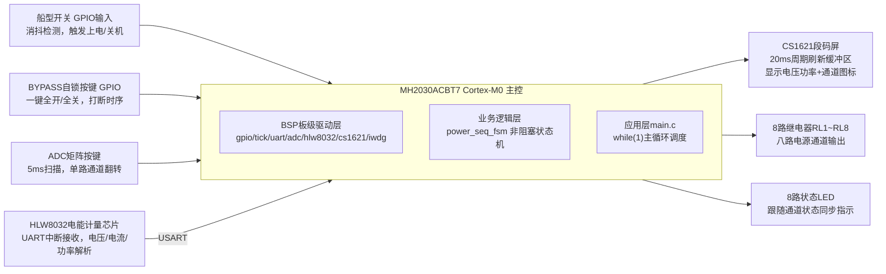
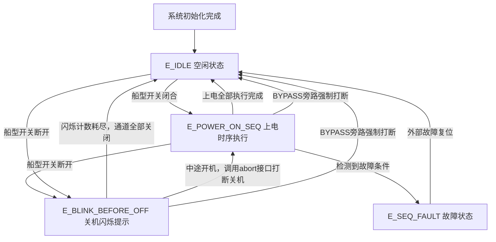

# 八路电源时序控制器（MH2030ACBT7）
> 实习项目｜国产MCU电源时序板国产化替代
MCU：MH2030ACBT7（Cortex‑M0）

## 项目方案
### 1. 项目背景与需求
基于兆讯恒达MH2030ACBT7，完成八路电源时序控制板国产化替代。
开发8通道电源时序控制器：实现通道延时上电、Bypass直通、按键控制、功率采集、段码屏显示功能。集成独立IWDG硬件看门狗，实现程序跑飞死机故障硬件自恢复。
可用于功放、音频设备上电时序管理，抑制上电冲击噪声。

**主要功能：**
1. 船型开关触发上电时序，关机前图标闪烁提示，逆序关闭通道
2. ADC分压矩阵按键，单独控制每一路通道通断
3. BYPASS自锁按键，一键全开 / 全关输出通道
4. HL‑388W2模块采集交流电压、电流、功率数据
5. CS1621段码屏实时显示电压功率、各路通道状态图标
6. IWDG独立看门狗，程序跑飞自动硬件复位，复位后全部继电器断开

### 2. 硬件架构
- 八路继电器GPIO输出，配套LED状态指示灯
- 输入：船型开关、BYPASS自锁按键、ADC矩阵按键
- 外设：HL‑388W032电能计量模块、CS1621段码屏

> 硬件注意：外部输入全部做软件消抖；继电器引脚增加下拉电阻，规避复位瞬间GPIO浮空带来的强电风险。

### 3. 软件总体设计
#### 3.1 软件分层
1. **BSP板级驱动层**
GPIO、1ms系统Tick、UART驱动、ADC按键扫描、HLW8032数据解析、CS1621段码屏驱动、IWDG看门狗。

2. **业务逻辑层**
`power_seq_fsm`电源时序有限状态机，为本项目核心业务模块。

3. **应用层 main.c**
大 `while(1)` 轮询架构，所有任务条件触发执行，**全程无阻塞延时**。

> 中断约束：SysTick、串口中断只负责原始字节接收、生成时基；业务解析、复杂逻辑全部放到主循环，不在中断内部执行业务代码。

#### 3.2 主循环任务调度
基于1ms tick时间戳实现定时、消抖、延时判断：
- 5ms周期：ADC按键扫描
- HLW8032收到完整数据包，执行数据解析
- 船型开关、BYPASS按键消抖检测
- 调用状态机运行函数执行电源时序逻辑
- 处理按键事件，切换通道开关状态
- 20ms周期统一刷新段码屏显示缓冲区

### 4. 模块设计要点
1. **电源时序FSM**：分为空闲、上电时序、关机闪烁、故障4种主状态；依靠时间戳差值实现延时；区分自动关机/手动关机模式；提供关机中止接口；状态、闪烁计数全部存放在状态机结构体，不使用函数static局部变量；BYPASS按键可强制复位状态机。
> E_IDLE空闲状态：系统待机稳态，保持当前继电器通道状态，持续监听按键事件，不自动执行上电或关机时序。BYPASS自锁按键锁存生效期间，屏蔽船型开关与ADC矩阵按键检测，仅保留BYPASS按键检测用于退出旁路模式。
> 限制：上电时序启动后不可中途停止；软件状态不会回读继电器硬件真实状态。

1. **按键处理**：船型开关、BYPASS按键做软件消抖；
   ADC矩阵按键采用**单通道电阻分压方案**：12位ADC单次阻塞采样，通过实测的电压区间查找表识别8路按键；主循环5ms周期轮询扫描，驱动内部实现5ms软件消抖。
> BSP输出按键电平，上层增加上升沿检测与`key_event_flag`事件锁存，只捕获按下瞬间，避免长按重复触发。
> 按键互斥：BYPASS自锁锁存时，屏蔽船型开关与ADC按键检测；释放后恢复全部按键扫描。
> 优化：增加基于系统tick的2ms超时保护，解决ADC EOC标志不置位造成while死循环风险，采用独立标记区分采样异常，避免与K1采样值0冲突。
> 局限：缺少采样均值滤波；消抖计时仅按下时重置；按键阈值为编译常量，硬件改版需重新标定；整机测试按键工作稳定。

1. **段码屏驱动**：业务层只操作内存缓冲区，硬件刷新收敛到主循环20ms周期执行，避免多处刷屏造成乱码抖动。

2. **HLW8032电能计量**：识别帧头0x55 0x5A完成数据包帧定位；Cortex‑M0无FPU，电流计算使用`uint32_t`32位整数规避浮点精度缺陷；两套功率计算模式可宏切换。

3. **看门狗可靠性**：LSI独立RC时钟，超时500ms；调试版本关闭，量产开启；仅在主循环末尾喂狗；复位后强制关闭全部继电器，保障强电安全。

## 流程图
### 系统软硬件数据流框图

### FSM 状态流转图

## 开发总结
### 1. 问题与踩坑记录
|现象|根因|解决措施|
|---|---|---|
|J‑Link烧录识别失败|MH2030芯片J‑Link适配兼容性差|配置对应Flash算法，修改JLinkSettings.ini配置文件|
|状态机卡死、时序错乱|代码存在阻塞延时；外部操作没有重置状态机|全部改用tick非阻塞架构；BYPASS操作强制复位状态机|
|ADC按键长按重复触发|持续采样有效电平，不断生成按键事件|仅检测按键上升沿，锁存事件标志|
|段码屏乱码闪烁|业务各处直接调用硬件刷屏|业务写内存缓冲区，统一周期刷新硬件|
|关机中途开机有残余延时|case分支执行过程不会立刻响应新状态|增加关机中止接口；接受架构带来最多一轮循环的固有延时|
|多次关机后图标不再闪烁|static局部变量残留旧状态；外部篡改状态机内部变量|子状态、闪烁计数全部存放在FSM结构体，外部只修改主状态|
|HL‑388W2功率读数异常|部分 HL‑388W2模组固件有功功率寄存器存在bug|切换视在功率模式，多负载点重新标定校准系数|
|功率读数与相差12%|部分 HL‑388W2模组固件有功功率寄存器存在bug|切换视在功率模式，多负载点重新标定校准系数|

### 2. 测试验证结果
1. 船型开关开关机：上电顺序打开通道，关机图标闪烁后逆序断电；
2. BYPASS旁路功能正常，一键全开全关；
3. ADC按键单路控制，关闭最后一路自动进入关机；
4. 关机过程可以被开机动作中止，多次开关机，关机图标每次均可正常闪烁；
5. 带交流负载，电压、功率计量与屏幕显示稳定；
6. 看门狗可靠性测试：注入死循环模拟死机，MCU自动复位，复位后继电器全部断开。

### 3. 拓展思考
1. 状态回读：软件不会回读继电器硬件状态，无法检测继电器粘连故障；
2. 动态配置：上电、下电延时为编译期常量，运行时不可动态配置；
3. 双重保险：ADC 分压按键 BSP 驱动已针对 ADC 转换卡死风险增加 2ms 超时防御保护；仍缺少多次采样均值滤波；消抖计时逻辑有局限；按键阈值为编译期常量。后续可进一步优化为 DMA + 中断非阻塞 ADC 采集，增加软件滤波与阈值动态校准接口。上层业务通过事件锁存已经规避长按重复触发问题，整机测试按键功能稳定。

## 📌返回导航
[⬅ 返回作品集首页](../../../README.md)