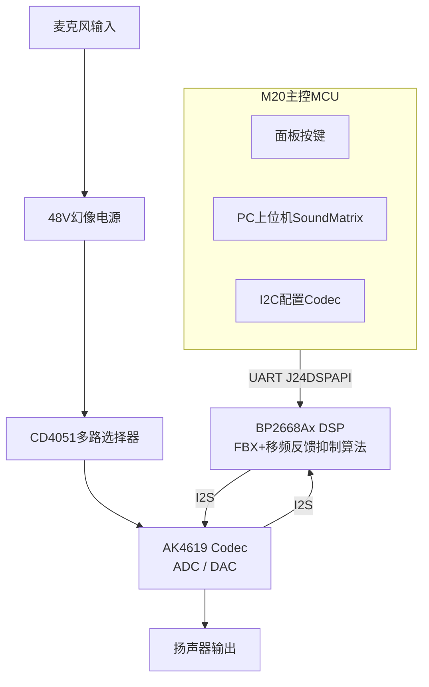

# J24数字调音台‑反馈抑制器
## 📋项目概述
本项目基于BP2668Ax数字音频DSP开发反馈抑制功能，整机由M20（AT32）作为主控MCU，DSP负责音频算法运算。
MIC模拟音频经过48V幻像电源、模拟多路开关、AK4619 Codec转换为I2S数字音频送入BP2668Ax；DSP实现**FBX自适应陷波啸叫抑制、移频防啸叫**；M20通过自定义COBS‑CRC串口协议下发算法参数，同时接收DSP周期上报的电平、频谱、啸叫状态，完成面板交互与上位机联动。
适用于扩声音响设备，解决麦克风与扬声器声学啸叫问题。

## 🧩硬件平台
- DSP：BP2668Ax数字音频DSP（运行FBX、移频算法）
- 主控MCU：AT32F421(M20)，负责按键、面板、串口协议、Codec I2C配置
- 音频Codec：AK4619VN，4通道ADC/DAC，I2S对接DSP
- 模拟前端：48V幻像电源、CD4051模拟多路选择器
- 通信链路：I2S（实时音频数据流）、UART（M20‑DSP控制指令）

## ⚡核心功能
1. FBX自适应陷波抑制：实时检测啸叫频点，动态生成Notch陷波滤波器压制啸叫，提供多档抑制强度
2. 移频防啸叫：微小频率偏移破坏声反馈相位条件，事前预防啸叫，适合讲话扩声场景
3. M20与DSP自定义二进制串口协议：COBS编码 + CRC32校验，一问一答ACK/NACK应答，支持DSP主动周期上报电平、RTA频谱、啸叫状态
4. 音频路由矩阵管理，必须将音频流路由到FX逻辑通道，算法才可生效
5. 区分硬件端口与逻辑音频通道，支持4路麦克风输入独立算法处理
6. 支持JTAG调试，UART0被I2S抢占不可用作打印，依靠上报报文输出调试信息

## 🔨编译运行
IDE环境：AndeSight（BP2668Ax DSP）、Keil‑MDK5（M20‑AT32）
1. DSP工程：配置修复链接脚本，关闭自动ld生成，编译生成DSP固件烧录BP2668Ax
2. M20工程编译烧录AT32，完成Codec初始化、串口协议初始化
3. 接入整机底板（Codec、48V、喇叭、麦克风），构建麦克风‑扬声器声学闭环，进行啸叫验证

## 🛠遇到的问题与解决方案
1. **FBX下发指令返回OK，但啸叫抑制完全无效果**
现象：M20发送使能FBX，DSP返回ACK成功，但啸叫依旧存在。
解决：需要提前调用`dsp_connector_neo()`配置音频路由，把MIC音频流送入FX逻辑通道；音频仅流入硬件ADC端口不会触发算法。

2. **串口报文随机错乱，CRC校验频繁失败**
现象：偶发报文解析失败，NACK应答增多。
解决：M20多线程调用API操作全局报文缓冲区增加互斥锁保护；协议解析、COBS解码、CRC校验放在普通任务线程，禁止在串口硬件中断内部执行。

3. **音频随机爆音，FBX出现误抑制**
现象：正常播放语音时，算法错误触发抑制，伴随杂音爆音。
解决：修改算法参数的写操作与音频回调读取参数增加临界区保护，避免参数处于半更新状态被音频调度读取。

4. **I2S音频业务下UART0无法输出调试打印**
现象：开启I2S之后UART0引脚被复用抢占，时钟源受APLL音频时钟漂移，无法输出日志。
解决：放弃UART0打印；使用JTAG监视全局变量、空闲GPIO翻转做调试；调试信息通过DSP readback上报报文推送给M20再转发上位机。

5. **编译链接脚本模板解析报错**
现象：nds_ldsag工具解析模板报语法错误，无法自动生成ld链接脚本。
解决：业务开发阶段关闭脚本自动生成ld逻辑，使用同SDK版本编译正常的固定ld文件；模板需要清除BOM、全角符号、块注释才能正常解析。

## 📁仓库目录说明
```
├── README.md               # 项目说明文档
├── design.md              # ✨【开发全文档】音频数据流、串口协议、API、踩坑清单
├── doc/
│   ├── images/            # 调试截图、整机框图
│   └── dev_checklist.md   # 开发任务Checklist
├── dsp_app/               # BP2668Ax DSP固件工程
├── m20_mcu/               # M20 AT32主控工程
└── .gitignore             # 编译临时文件过滤
```
## 📎流程图


## 📌返回导航
[⬅ 返回作品集首页](../../../README.md)