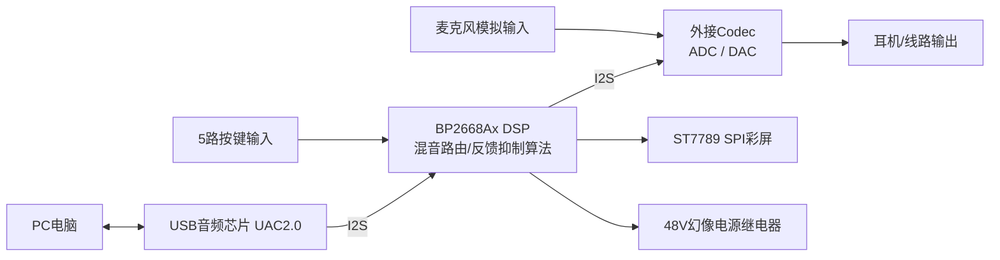

# BP2668Ax 2×2桌面声卡
## 📋项目概述
本项目基于BP2668Ax数字音频DSP，实现一款2×2桌面USB音频声卡。
DSP完成数字音频路由混音，实现Monitor零延迟硬件监听、Loopback系统音频内录；外接Codec完成模拟信号AD/DA转换，搭配USB音频芯片实现UAC2.0声卡枚举；支持按键控制、SPI彩屏状态显示、48V幻像麦克风供电；集成移频、FBX自适应陷波反馈抑制算法抑制啸叫。
适用于直播、录音、桌面音频设备，实现麦克风监听、系统音频内录、抑制声学啸叫。

## 🧩硬件平台
- 主控DSP：BP2668Ax（纯数字音频DSP）
- USB音频：AU7860 / CM6642A，实现UAC2.0，I2S和DSP对接
- 音频Codec：ES8388 / AK4619VN，ADC/DAC模数数模转换
- 输出单元：48V幻像电源继电器控制电路
- 显示单元：2寸ST7789 SPI彩屏(240×320)
- 输入外设：5路轻触按键（Monitor×2、Loopback×1、48V×2）

## ⚡核心功能
1. Monitor零延迟监听：模拟输入直接混入播放通路，硬件链路低延迟监听麦克风
2. Loopback内录：PC播放音频混入录音通路，实现系统音频内录
3. 48V幻像电源，双通道独立继电器开关，适配电容麦克风
4. 按键支持短按切换功能，Monitor按键支持长按切换立体声/单声道模式
5. SPI彩屏实时显示输入输出电平VU条、功能开关状态、声道模式
6. 反馈抑制：移频+FBX自适应陷波滤波器，抑制麦克风声学啸叫
7. 软件分层设计，支持硬件未到货阶段开发上层业务，底层驱动空桩填充

## 🔨编译运行
IDE环境：DSP配套编译环境
1. 打开DSP工程，编译生成固件镜像
2. 将固件烧录至BP2668Ax开发板
3. 外接Codec、USB音频芯片、屏幕按键外设，上电运行

## 🛠遇到的问题与解决方案
1. **音频爆音、实时性风险**
现象：SPI屏幕SPI传输如果放在音频回调内部执行，抢占音频处理时间片，会产生爆音噪声。
解决：音频回调只做电平峰值计算；屏幕UI刷新放到主循环低优先级任务，做50ms时间节流，禁止在音频中断执行SPI硬件操作。

2. **混音开关切换pop爆破音**
现象：Monitor/Loopback直接0/1突变修改混音增益，切换瞬间出现爆破pop噪音。
解决：不直接硬切增益，做5ms增益渐变平滑过渡，避免音频阶跃突变。

3. **全局状态多副本不一致风险**
现象：混音、继电器、算法模块各自维护状态变量，多处修改容易出现状态不同步bug。
解决：设计`SystemState_t`单一数据源结构体，统一封装Set/Get接口，业务层禁止直接修改各模块内部全局变量。

4. **引脚IO资源紧张冲突**
现象：I2S音频外设占用大量GPIO，按键、SPI屏幕、继电器引脚容易发生IO复用冲突。
解决：前期做完整引脚资源分配总表，编译关注IO复用警告；UART0被I2S占用，放弃UART0调试，预留UART1作为后期调试扩展。

5. **按键长短按识别**
现象：按键消抖、长按标志处理不当，会出现长按触发后重复上报事件。
解决：1ms定时器做按键扫描；设置`long_press_flag`标记，长按只触发一次；按键释放再清除标记。

## 📎流程图

## 📌返回导航
[⬅ 返回作品集首页](../../../README.md)