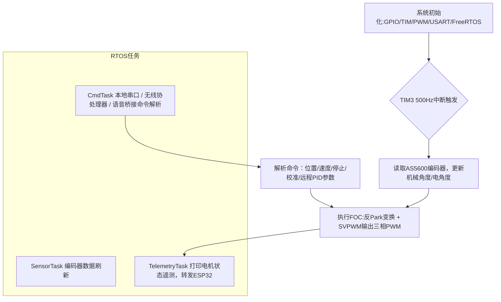

# FOC-BLDC 无刷电机控制器 详细设计文档
> 项目仓库：personal_project_01_foc-bldc-moto
> 主控：正点原子 STM32F103xE | 构建方式：CMake + Keil MDK双工程
> 控制方案：电压模式FOC，SVPWM驱动PMSM外转子电机

## 1. 项目概述
### 1.1 项目目标
设计一套分层模块化的PMSM FOC矢量控制器，实现电机角度采集、SVPWM调制、闭环调速控制。项目追求软硬件解耦，算法代码与底层硬件驱动分离，支持跨平台编译；外接无线协处理器，实现电机参数远程调参与状态无线上传，兼顾可移植性与可维护性。

### 1.2 技术指标
| 项目 | 参数 |
|---|---|
| 主控芯片 | 正点原子 STM32F103xE |
| 电机对象 | 2804外转子PMSM |
| 位置采集 | AS5600磁编码器 |
| PWM输出 | TIM1，40kHz 中心对齐三相PWM |
| 控制周期 | TIM3，500Hz闭环控制中断 |
| 通信接口 | USART1（本地串口调试、上位机命令），USART3（语音桥接输入） |
| 无线协处理器 | 嘉立创 ESP32 + ESP8266模组，负责参数无线上传、远程调参 |
| 构建系统 | CMake(arm-none-eabi-gcc / clang) + MDK-ARM Keil |

### 1.3 软件分层架构
项目采用三层软件架构，职责分离，实现算法与硬件解耦。
```
├── algorithm/              # 算法层：纯数学算法，无硬件依赖，可移植
├── Core/                   # 应用核心层：业务逻辑、RTOS任务、事件管理、中断服务
└── Drivers/                # 硬件驱动层：外设底层读写，不实现复杂业务
```
- **算法层 `algorithm/`**：FOC坐标变换(Clarke/Park/反Park)、SVPWM、数字滤波。代码不调用任何MCU外设接口，可直接移植到PC仿真或其他MCU平台。
- **核心层 `Core/`**：RTOS多任务管理、事件标志组、电机状态机、控制中断业务、串口命令解析、运行日志输出，和无线协处理器进行数据交互。
- **驱动层 `Drivers/`**：封装硬件外设，包含CMSIS内核基础、电机PWM/编码器底层驱动、语音桥接外设驱动。仅负责硬件读写，不嵌入控制算法。

> 工程双构建方案：
> 1. CMake：跨平台自动化构建，支持GCC/Clang两套交叉编译器，适配Windows/Linux环境；配置脚本存放于`cmake/`目录。
> 2. MDK-ARM Keil：传统IDE工程，用于本地快速调试，作为备选开发方案。

## 2. 硬件设计
硬件详情参考 `doc/hardware.md`
### 2.1 硬件清单
- 主控：正点原子 STM32F103xE
- 驱动板：SimpleFOC Mini功率驱动板
- 电机：2804外转子PMSM无刷电机
- 位置传感器：AS5600磁编码器
- 无线协处理器：嘉立创 ESP32 + ESP8266模组

### 2.2 信号链路
`AS5600磁编码器(I2C) → Core读取角度 → algorithm执行FOC矢量计算 → TIM1生成SVPWM三相PWM → SimpleFOC驱动板 → PMSM电机`
`STM32 <-> ESP32+ESP8266无线协处理器：串口交互，电机状态上传、远程下发调参指令`

### 2.3 关键硬件约束
1. TIM1高级定时器生成40kHz中心对齐PWM，作为电机功率驱动信号
2. TIM3定时器500Hz触发，作为FOC闭环控制运算中断
3. USART1用于本地串口调试、上位机下发控制指令，打印运行状态；USART3预留语音桥接输入接口
4. STM32与ESP32/ESP8266模组串口通信，由协处理器完成WiFi数据收发，实现远程调参、电机运行参数云端上传。

## 3. 软件详细设计
### 3.1 algorithm 算法模块
文件：`filter.c / filter.h`
- 实现**一阶低通数字滤波**，传递函数：`out = alpha * input + (1 - alpha) * last_output`。
- 用途：对AS5600磁编码器原始角度采样值做平滑降噪，抑制采样噪声，改善电机低速抖动问题。
- 模块纯数学运算，无任何硬件寄存器操作，输入输出为浮点数，可单独提取到PC做算法仿真，具备跨平台移植能力。

> FOC算法：Clarke变换、Park变换、反Park变换、SVPWM调制、速度环PID闭环控制。
> 输入：电机机械角度；输出：三相PWM占空比。

### 3.2 Core 核心业务模块
> Core/Src 基于FreeRTOS + CMSIS-RTOS2，多任务+事件标志组实现任务解耦
- `app_event.c`：事件标志组管理模块，提供事件触发接口，通知日志打印任务、串口指令接收任务；任务间使用事件标志代替轮询，降低CPU占用。
- `app_log.c`：日志模块，输出电机角度、转速、运行状态，支持本地串口输出与转发给无线协处理器。
- `freertos.c`：FreeRTOS系统初始化，任务创建、堆栈大小与优先级配置。
- `gpio.c`：GPIO底层初始化，电机使能引脚、指示灯IO配置。
- `main.c`：程序入口，硬件外设初始化、RTOS启动、系统总调度。
- `stm32f1xx_hal_msp.c`：HAL库底层外设回调初始化。
- `stm32f1xx_it.c`：中断服务函数，定时器、串口中断入口。
- `syscalls.c` / `sysmem.c`：半主机、堆内存配置，适配GCC编译。
- `system_stm32f1xx.c`：系统时钟配置。
- `tim.c`：定时器初始化，TIM1生成40kHz中心对齐PWM、TIM3 500Hz控制中断配置。
- `usart.c`：串口外设初始化，USART1本地调试、USART3语音桥接，以及和ESP32/ESP8266通信串口。

- **电机状态机**：停机 → 上电自检 → 开环强制启动 → 闭环FOC运行。开环启动解决磁编码器初始角度不确定问题，达到指定转速后平滑切换闭环控制。
- **中断服务**
  - TIM1：高级定时器，配置为中心对齐3模式，输出40kHz三相PWM波形，通道映射PE9/PE11/PE13，驱动SimpleFOC Mini功率板；TIM1死区配置为0，由驱动板硬件实现上下桥防直通保护，仅负责PWM波形硬件输出。
  - TIM3：500Hz周期定时器中断，作为FOC控制周期。中断回调函数`HAL_TIM_PeriodElapsedCallback`，**不直接执行I2C编码器读取**，通过FreeRTOS任务通知唤醒SensorTask，在任务上下文读取AS5600，避免慢速I2C阻塞中断；中断内读取缓存角度并调用`motor_control_update()`执行FOC矢量运算。
  > 工程权衡：当前500Hz控制周期下FOC浮点运算耗时较短，放在中断回调；后续优化计划：将FOC运算迁移至RTOS任务，缩短中断执行时长，提升系统实时性。
  - USART1、USART3中断入口预留，用于本地串口指令、ESP无线协处理器通信，后续增加环形缓冲区完成串口帧解析。
  > 共享变量保护：编码器角度缓存`encoder_angle_cache`在中断与SensorTask之间共享，当前版本未增加临界区保护，属于待优化点，多任务并发场景可能出现数据撕裂。
- **串口交互**：USART1接收本地上位机指令；串口对接ESP32/ESP8266协处理器，接收远程调参指令、上报电机运行数据；USART3预留语音桥接扩展接口。


### 3.3 Drivers 驱动模块
- `Drivers/motor`：电机底层外设驱动，PWM初始化、编码器I2C读取函数，只提供基础读写接口，不包含FOC控制逻辑。
- `Drivers/voice_bridge`：语音桥接外设驱动，USART3外设初始化，预留语音指令接入能力。
- `CMSIS`：ARM内核标准头文件，提供内核寄存器定义。

### 3.4 CMake工程构建模块
目录：`cmake/`
1. `gcc-arm-none-eabi.cmake`：arm gcc交叉编译链配置，指定芯片架构、编译优化等级、警告选项、链接脚本。
2. `starm-clang.cmake`：备选clang编译器配置，用于尝试Clang编译优化。
3. `stm32cubemx/`：CMake对接STM32CubeMX自动生成代码脚本，实现CubeMX外设代码自动导入工程。

根目录 `CMakeLists.txt`：整个工程顶层构建脚本，管理所有源文件、头文件路径、编译目标。

### 3.5 MDK-ARM Keil工程
`MDK-ARM/` 目录存放Keil uvprojx工程，作为备选开发环境。启动汇编文件`startup_stm32f103xe.s`负责芯片上电初始化，设置堆栈，跳转到main函数。
> 说明：同一套源码，CMake与Keil双工程共用业务代码，保证两套环境行为一致。

## 4. 测试与问题复盘
### 4.1 测试方案
1. 算法仿真：将`algorithm`内滤波、FOC算法提取，PC端浮点数仿真验证数学模型正确性。
2. 单板硬件测试：I2C读取AS5600角度，验证角度采样稳定性；PWM波形示波器观测。
3. 整机联调：电机开环启动、闭环调速，验证本地串口调参；对接ESP32模组，测试无线远程下发参数、状态上传。

### 4.2 踩坑与解决方案
1. 编码器采样噪声大，电机低速抖动：新增`filter.c`一阶低通滤波对原始角度数据平滑，抑制采样噪声，改善低速运行抖动问题。
2. 开环切换闭环瞬间电机抖动：优化状态切换阈值，增加过渡平滑加权算法，降低模式切换冲击。
3. 浮点数运算耗时与中断实时性权衡：初期将FOC运算放在TIM3中断回调中，500Hz控制周期下可稳定运行；但中断内执行浮点运算存在潜在风险，后续优化计划将FOC计算迁移至RTOS任务，缩短中断执行时长，提升系统整体实时性。
4. 共享变量数据撕裂风险：编码器角度缓存`encoder_angle_cache`在TIM3中断与SensorTask任务间共享，当前未添加临界区保护，并发访问场景下可能出现角度数据错乱，后续增加`taskENTER_CRITICAL()`/`taskEXIT_CRITICAL()`临界区保护。
5. 串口通信丢包：STM32与ESP32/ESP8266无线协处理器串口通信时出现报文丢失，增加帧头帧尾校验，搭配环形接收缓冲区，提升串口通信可靠性。
6. PWM死区配置取舍：TIM1死区参数配置为0，由SimpleFOC Mini驱动板硬件实现上下桥MOS管防直通保护；若更换自研功率板，需软件配置TIM1死区时间，防止桥臂直通烧毁功率器件。


## 5. 现有局限 & 后续预研优化方向
### 5.1 当前项目不足
1. 缺少硬件电流采样，仅电压模式FOC，无电流内环保护，过流无法检测。
2. 缺少上位机可视化波形工具，调参依赖串口文本打印或无线报文。
3. 无故障保护逻辑（堵转、过温保护）。
4. 无线模组仅做透传，无边缘侧数据处理能力。

### 5.2 后续预研方案（未实现）
1. 增加电流采样电路，升级为电流环+速度环双闭环FOC，增加过流保护。
2. 开发上位机，实时绘制转速、角度波形，支持在线PID调参。
3. 增加通信协议，支持更多参数远程配置。
4. 预研：ESP32接入Linux边缘网关，基于大模型做电机故障预测、智能调速。

---
### 配套mermaid控制流程


## 📌返回导航
[⬅ 返回作品集首页](../../README.md)
