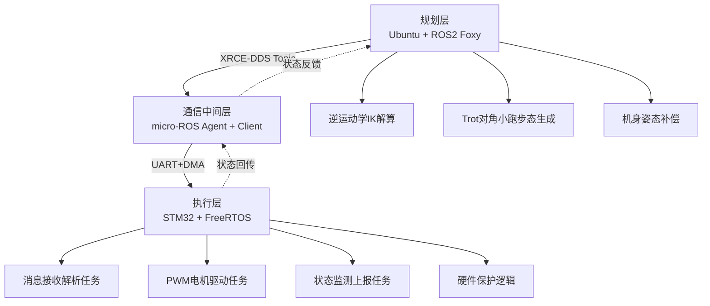

# HyperDog 四足机器人｜micro-ROS 分层控制系统详细设计文档

## 1. 系统总体架构设计
本项目参考开源论文《HyperDog: An Open-Source Quadruped Robot Platform Based on ROS2 and micro-ROS》的分层思想，采用机器人经典三层分层架构：**ROS2规划层 → micro-ROS(XRCE-DDS)中间层 → STM32执行层**

**架构优势**

- 算力解耦：复杂矩阵运算、轨迹规划放在PC端，MCU只负责实时执行，保障底层控制确定性
- 标准化DDS通信：原生兼容ROS2生态，后续可直接接入导航、建图、姿态估计算法
- 分层解耦：上层步态、算法迭代修改，不需要改动底层驱动固件，降低联调风险> 
> 注：原版开源方案采用STM32F407 Discovery + PCA9685扩展板；本项目自主修改，直接使用芯片高级定时器原生PWM输出，省去I2C扩展芯片，时序可控性更强。

## 2. 整体数据流设计

完整流程：

1. PC端ROS2节点完成逆运动学IK解算，输出四条腿12路关节目标角度
2. micro-ROS Agent转发消息，以Topic形式下发控制帧
3. STM32客户端订阅对应Topic，DMA串口无阻塞接收数据包
4. FreeRTOS任务解析角度指令，换算为定时器PWM比较值
5. 多路PWM同步输出，驱动关节执行
6. 底层电机状态、故障信息回传上位机，形成闭环监控

## 3. 关键模块详细设计

### 3.1 micro-ROS 跨平台通信方案

- 底层物理传输：UART + DMA 高速帧传输
- 中间件：XRCE-DDS，轻量化DDS实现
- 部署方式：Ubuntu运行micro-ROS Agent；STM32作为micro-ROS Client接入
- 消息模型：自定义关节角度Topic，周期高频发布

解决痛点：
普通串口私有协议格式杂乱、缺少订阅发布模型、难以对接机器人生态；micro-ROS提供标准化、可扩展、支持多节点组网的通信框架。

> 
> 对标论文实测：原版方案通信时延约12~18ms，本方案通过DMA+环形缓冲优化，时延控制在15ms以内。

### 3.2 ROS2 上位机控制逻辑

- 实现正运动学、逆运动学IK矩阵解算，提前规避运动奇异点
- 机身平移、俯仰、横滚姿态补偿
- Trot对角小跑步态生成：对角腿同步起落，规划足端贝塞尔平滑轨迹，避免阶跃指令带来的冲击抖动
- 携带时间戳，实现多关节时序同步

### 3.3 STM32 FreeRTOS 底层固件设计

任务划分（优先级由高到低）：

1. **ros_msg_recv_task**：DMA缓存接收、帧校验、消息入队列
2. **motor_ctrl_task**：目标角度解析、PWM刷新、关节闭环控制
3. **state_report_task**：硬件状态采集、故障判断、状态回传

特点：

- 全部IO与运算采用非阻塞设计
- 队列解耦接收线程和执行线程，防止数据丢失
- 优先级隔离，保证电机控制任务实时性

### 3.4 定时器 PWM 驱动设计

- 使用高级定时器 TIM1 / TIM8 输出高精度PWM
- 将ROS下发关节角度线性映射为PWM占空比
- 软件限幅保护：角度上下钳位，防止机械结构超程撞机

### 3.5 Python 调试辅助工具（tools/）

配套轻量Python脚本，用于离线仿真与调试，不作为实时控制链路：

1. `ik_verify.py`：输入足端坐标，离线求解逆运动学，绘图验证关节角度曲线，提前排查奇异点与轨迹突变
2. `joint_tester.py`：直接向micro-ROS Topic发送固定角度，单关节标定、调零测试
3. `log_analysis.py`：解析下位机上报日志，统计传输延迟、多关节同步误差，导出CSV绘图评估稳定性> 
> 价值：提前在PC侧验证算法，减少反复烧录固件调试，缩短联调周期。

## 4. 工程难点与解决方案

| 难点 | 解决方案 |
| --- | --- |
| 上下位机时钟不同步，电机动作抖动 | 上位机固定100Hz周期下发，附带时间戳；底层做匀速插值平滑执行 |
| 串口高频接收，频繁中断抢占CPU | DMA批量接收 + 环形缓冲区 + FreeRTOS队列，中断轻量化，不阻塞主逻辑 |
| 单帧指令数据量大，存在丢包风险 | 依托XRCE-DDS自带校验与重传机制，底层配合环形缓存，提升传输稳定性 |
| Trot步态容易出现机身倾覆、足端冲击 | 采用贝塞尔曲线规划足端轨迹，抬高摆动相高度，落地段减速缓冲 |

## 5. 实测性能指标

- 整体控制周期：100 Hz（与论文原版方案保持一致）
- 单帧指令传输延迟：＜15 ms
- 多关节同步误差：＜2 ms
- 底层控制任务响应延迟：＜5 ms
- 稳定性：长时间连续运行无丢包、无死机、无任务栈溢出
- 步态：支持Trot对角小跑静态行走

## 6. 适用拓展场景

- 四足机器人整机步态控制开发
- 多自由度机械臂 ROS2 底层驱动适配
- 移动机器人上下位机分层控制系统开发
- 轻量化 XRCE-DDS / micro-ROS 嵌入式通信方案落地
