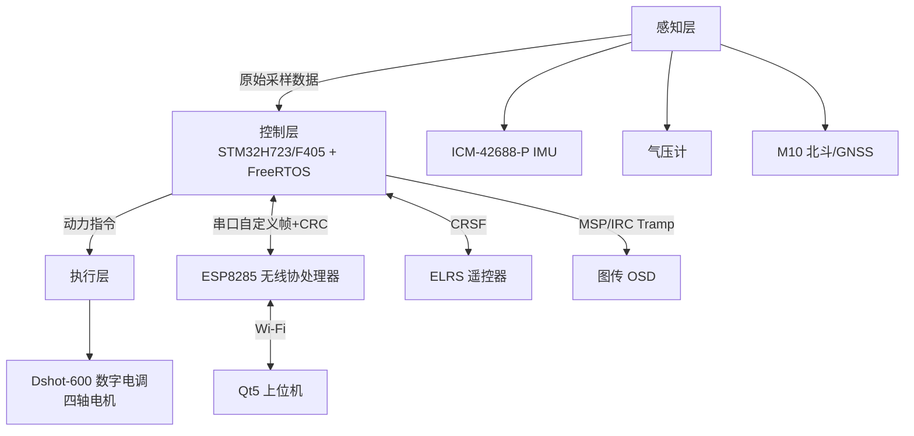

# 北斗/GNSS 定位飞控系统｜详细软硬件设计文档

## 1. 系统整体架构设计
本飞控采用 **分层模块化 + 双芯片异构架构**，分为感知层、控制层、执行层、交互通信层。



**架构优势**

- 业务解耦：实时控制、无线交互、图传遥测相互隔离，按优先级调度
- 双芯片分工：STM32 承载硬实时控制任务；ESP8285 专职 Wi‑Fi 透传、调参、日志转发
- 模块化设计：传感器、控制算法、驱动、通信独立，方便迭代、调参、裁剪移植

## 2. 整体数据流链路

```
flowchart LR
    S[传感器采集] --> F[滤波与多传感器融合]
    F --> K[姿态/位置解算]
    K --> PID[四级串级PID闭环计算]
    PID --> D[Dshot-600 电机输出]

    R[ELRS遥控器指令] --> M[飞行模式/目标指令校正]
    M --> PID
    PID --> O[MSP OSD数据打包]
    O --> T[图传叠加 + 遥测上行]

    PC[Qt上位机] --> W[ESP8285 Wi-Fi透传]
    W --> P[飞控参数热更新]
    PID --> W
```

两条主线：

1. **控制主线**：传感器采样 → 融合解算 → 串级PID → Dshot电机驱动
2. **交互主线**：遥控指令输入、上位机参数下发、状态与遥测数据回传

## 3. 核心模块详细设计

### 3.1 多传感器数据融合模块

- 器件：ICM‑42688‑P 六轴IMU、气压计、M10 北斗GNSS模组
- 分工策略：
  - IMU：高频输出，负责姿态动态跟踪
  - 气压计：提供高度观测，抑制垂直漂移
  - GNSS：提供经纬度，实现水平位置闭环
- 融合逻辑：采用时间戳对齐的加权融合，补偿各传感器更新速率不一致的问题，降低噪声与漂移。

### 3.2 四级串级PID闭环控制系统

由内向外嵌套四层闭环，内环响应快、外环约束慢：

1. **角速度环（内环）**：抑制抖动，提升动态响应
2. **角度环（中环）**：维持机身水平姿态
3. **高度环（外环）**：气压计定高，锁定垂直位置
4. **位置环（最外环）**：GNSS经纬度闭环，实现定点悬停

分层控制避免单一闭环无法定点、受风漂移、震荡等问题。

### 3.3 Dshot‑600 高速数字电调驱动

放弃传统模拟PWM调速，自研Dshot‑600数字驱动：

- 通信速率600k，数字指令抗干扰更强、无死区、线性度好
- 定时器+DMA发送，保证四路电机同步输出，抑制差速偏航
- 放在FreeRTOS高优先级任务，严格保障控制时序稳定

### 3.4 远距离无线链路协议适配

#### ELRS (CRSF) 遥控遥测

- 移植CRSF协议栈，解析摇杆通道、飞行模式开关指令
- 上行回传姿态、电压、位置等状态，实现低延迟双向遥测

#### MSP OSD + IRC Tramp 图传系统

- MSP协议打包飞行数据，叠加到图传画面
- IRC Tramp协议动态控制图传功率、频段、信道
- 飞行状态、告警信息可视化，便于外场调试

### 3.5 STM32 + ESP8285 双芯片协同架构

- STM32H7/F4：姿态解算、PID运算、Dshot驱动、故障保护（硬实时核心）
- ESP8285：Wi‑Fi透传、在线调参、日志上传
- 芯片间通信：自定义帧格式 + CRC16校验，分包传输、丢包过滤
- 核心收益：无线业务阻塞不会抢占飞控控制时序

### 3.6 Qt5 跨平台上位机设计

基于Qt5开发桌面/安卓双端GUI：

- 实时绘制IMU、高度、位置波形曲线
- PID参数在线热更新、一键保存/复位
- 飞行模式切换、设备状态监控、飞行日志导出
- 解决传统地面站调试繁琐、数据可视化弱的痛点

## 4. 工程难点与解决方案

| 难点 | 解决方案 |
| --- | --- |
| 多传感器更新频率不一致，融合后姿态抖动 | IMU高频做主状态，GNSS/气压计低频校准，时间戳对齐融合 |
| 多级PID相互耦合，容易超调震荡 | 由内向外逐级整定，先稳内环，再调外环，降低耦合干扰 |
| Dshot时序要求严苛，容易出现帧错位 | 定时器精准时序 + DMA发送 + 帧间隔保护，四路同步输出 |
| 串口无线通信粘包、丢包、乱码 | 帧头帧尾标识 + CRC16校验 + 状态机解析，丢弃错误帧 |
| 上位机高频上报导致UI卡顿 | 数据降频上报、队列缓冲、数据线程与UI线程解耦 |

## 5. 系统实测性能指标

- 姿态解算频率：500 Hz
- 角速度/角度内环PID：500 Hz
- GNSS位置闭环：10 Hz（GNSS标准输出频率）
- Dshot电机刷新：600 Hz
- 遥控响应延迟：＜20 ms
- GNSS定点水平漂移：±0.5 m
- 气压定高误差：±0.3 m
- 支持模式：自稳、定高、GNSS定点

## 6. 项目工程价值

覆盖传感器驱动、多传感器融合、多级闭环控制、高速数字协议、跨芯片协同、无线遥测、Qt上位机开发，是典型嵌入式实时控制系统。
技术栈可迁移到无人机、移动机器人、姿态导航、测控类嵌入式岗位。
