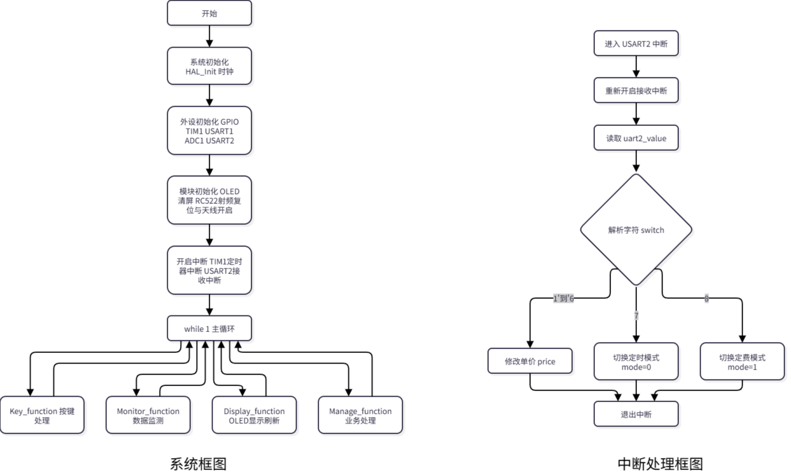
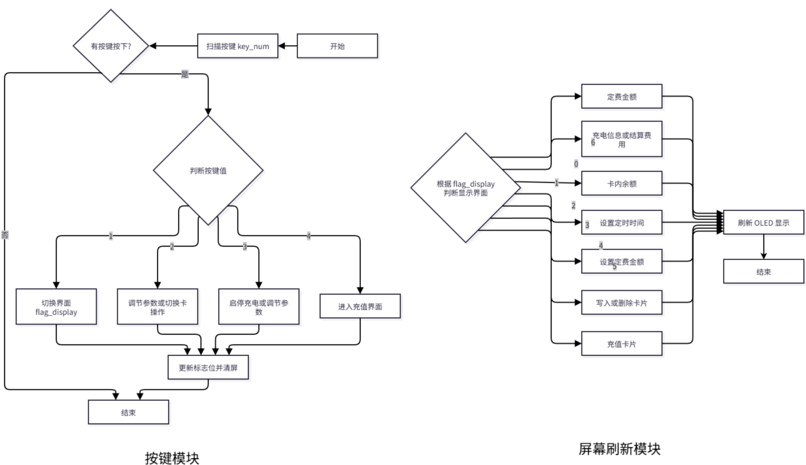
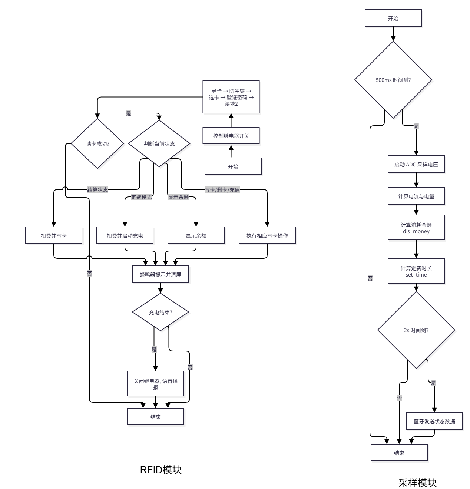

# 基于STM32的RFID充电桩控制系统
> 个人贡献：负责主控软件全流程开发、RC522‑RFID驱动开发、充值扣费计费业务逻辑实现、整机联调与PCB问题排查。

硬件完整说明参见 [`./doc/hardware/hardware.md`](./doc/hardware/hardware_.md)

## 一、项目背景与目标
射频识别技术适合无人值守设备的身份校验与电子结算，本项目基于STM32F103C8T6设计嵌入式自助充电桩控制器，用于自助充电场景，实现刷卡鉴权、卡片余额读写扣费、定时/定费双模式充电、电池电参采集、OLED本地交互、蓝牙上位机通信。

系统业务闭环：卡片身份校验 → 余额判断 → 充电启停控制 → 实时采集电压电流并计费 → 充电结束刷卡扣费回写余额。
异常场景支持声光告警（无效卡片、余额不足、充电超时），实现安全的无人自助充电。

### 主要功能目标
1. RFID非接触刷卡识别，身份校验、余额读取、充值、扣费写卡；
2. 支持**定时充电**、**按金额定费充电**两种工作模式；
3. ADC实时采集电池电压、电流，OLED可视化展示运行参数；
4. 继电器硬件控制充电回路，计时/计费用到阈值自动断电；
5. 蓝牙透传：周期性上报整机状态，接收上位机配置指令；
6. 异常保护：余额不足、无效卡片、充电超时声光提示；
7. 本地按键交互：界面切换、参数配置、卡片充值操作。

## 二、系统架构设计
整体采用**分层模块化前后台架构**，分为交互层、控制层、执行感知层。
业务闭环：`刷卡识别 → 计费决策 → 充电执行 → 状态反馈 → 结算扣费写卡`。

### 交互层
- 上位机：蓝牙APP/PC串口助手，下发电价设置、模式切换指令；
- 本地输入：独立按键，界面切换、定时/金额参数配置、卡片充值操作；
- 本地输出：0.96寸OLED显示电压、电流、余额、费用、充电状态；蜂鸣器做操作与异常告警提示。

### 控制层
STM32F103C8T6作为控制中枢，完成蓝牙指令解析、RFID卡数据处理、ADC采样滤波、定时器计时计费、继电器驱动、业务状态调度。

> 软件采用**前后台架构**
> - 主循环：按键扫描、数据监测、屏幕刷新、业务逻辑；
> - TIM1定时器提供1ms系统节拍，实现500ms采样、2s蓝牙上报、充电计时；
> - USART2串口中断，接收蓝牙上位机下发指令。

### 执行与感知层
- RC522 RFID模块：寻卡、防冲突、密码校验、Mifare卡片余额读写；
- ADC外设：采集电池电压、电流信号；
- DS18B20预留接口：可扩展电池温度监测、过温保护；
- 继电器+充放电模块：功率回路开关，控制充电启停；
- USART2对接蓝牙模块；USART1对接语音播报模块；OLED、蜂鸣器本地提示。

### 工作模式说明
1. **定时充电模式**：用户设定充电时长，倒计时结束继电器自动断开，进入结算界面；
2. **定费充电模式**：输入消费总金额，结合单价换算充电时长，到达阈值停止充电，等待刷卡扣费。

充电结束屏幕展示本次消费，刷卡扣费并将新余额写入RFID卡片；余额不足触发蜂鸣器告警。

蓝牙通信规则：每2s向上位机推送运行数据（充电状态、电压、电流、工作模式、余额、定时时间、定费金额、单价）；
上位机指令：`1~6`修改电价，`7`切换定时模式，`8`切换定费模式。

## 三、软件设计与实现
软件采用模块化前后台架构。主程序负责初始化、外设配置、循环业务调度；中断处理高实时性任务（系统计时、蓝牙接收）；
主循环与中断依靠标志位同步：`time_500ms`、`uart_2s`、`time_start`、`flag_switch`。

### 3.1 主程序（后台循环）
执行流程：
1. 系统初始化：HAL库、系统时钟，配置GPIO、TIM1、USART1、ADC1、USART2；
2. 开启外设中断：TIM1定时器中断、USART2串口接收中断；
3. 模块初始化：OLED初始化、RC522复位与天线配置；
4. 进入`while(1)`主循环，循环调用4个核心函数：
    - `Key_function()`：非阻塞按键扫描，切换界面、修改充值/定时/定费参数；
    - `Monitor_function()`：500ms周期ADC采样，计算电量与消费金额，每2s触发蓝牙上报；
    - `Display_function()`：基于状态机刷新OLED，展示电压电流、余额、费用；
    - `Manage_function()`：RFID寻卡、身份校验、读写卡、扣费充值业务；充电结束关闭继电器，等待刷卡结算。

### 3.2 中断服务程序（前台实时任务）
#### TIM1 1ms定时器中断
- 维护系统毫秒计数；
- 500ms标志置位，触发ADC采集任务；
- 充电模式累加计时，定时/定费到达阈值置充电结束标志；
- 继电器运行时长上限保护；
- 2000ms置位蓝牙上报标志，实现每2s上传状态。

#### USART2 蓝牙串口接收中断
- 重新开启接收中断；
- 获取上位机单字节指令，switch‑case解析：
  - `1~6`：修改电价单价price
  - `7`：切换定时模式 mode=0
  - `8`：切换定费模式 mode=1

### 3.3 核心子函数说明
- `Key_function`：非阻塞按键扫描；按键1切换界面，按键2/3增减参数，按键4快速跳转充值界面。
- `Monitor_function`：ADC采样换算电压电流，按分钟向上取整计算消费金额。
- `Display_function`：状态机驱动OLED多页面渲染；结算页展示本次充电消费。
- `Manage_function`：RFID业务核心；循环寻卡；结算状态刷卡扣费写卡；充值/写卡执行卡片存储操作；充电结束关闭继电器，等待刷卡结算。

> 软件流程拆分为3张子图，分别描述鉴权、计费、异常保护逻辑

| 鉴权流程 | 计费流程 | 异常保护流程 |
| ---- | ---- | ---- |
|  |  |  |

## 四、整机测试、调试与踩坑复盘

整机测试项：刷卡鉴权、余额充值扣费、定时/定费充电、自动断电保护、蓝牙数据上报。

### 4.1 测试方案
1. 外设单项测试：OLED、按键、蜂鸣器、RC522读卡写卡、继电器输出；
2. 业务逻辑测试：定时充电、定费充电、余额不足、无效卡片等异常场景；
3. 联调：蓝牙上位机下发指令，观测上报数据是否正确。

### 4.2 踩坑与解决方案
1. **RC522读卡距离衰减**：天线靠近继电器、电源电感会降低读卡灵敏度；解决：PCB布局远离功率器件，天线区域禁止铺铜；
2. **ADC采样抖动**：电压电流采样数值跳动；解决：软件多次采样取平均值滤波。

经过调试，系统实现刷卡自助充电、计费扣费写卡、超时自动断电、状态显示，达成全部设计目标。

## 五、现有局限 & 后续预研优化方向
### 5.1 当前不足
1. Mifare‑S50卡片使用明文扇区密码，安全级别有限，不适合高安全要求商用场景；
2. 无硬件过流保护，完全依靠模块自带保护与软件判断；
3. 没有参数掉电存储，重启后电价参数恢复默认；
4. DS18B20温度接口仅预留，未实现电池过温保护逻辑。

### 5.2 后续预研优化
1. 增加片内Flash模拟EEPROM，实现电价参数掉电保存；
2. 完善DS18B20温度采集，增加电池过温保护，温度超标切断充电；
3. 升级通信，增加RS485 Modbus‑RTU，支持多台充电桩组网；
4. 优化RFID安全机制，更换加密卡片，提升数据安全性。

## 📌返回导航
[⬅ 返回作品集首页](../../../README.md)
