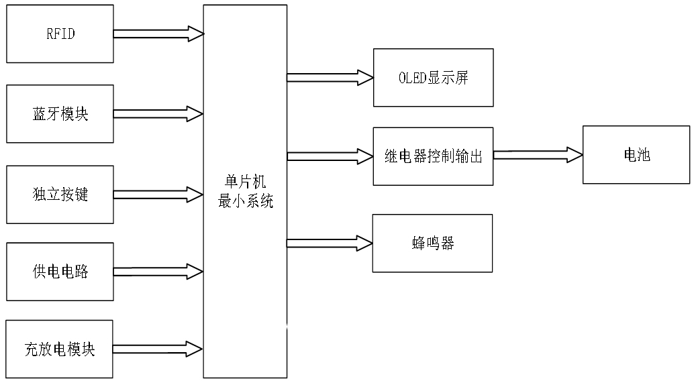
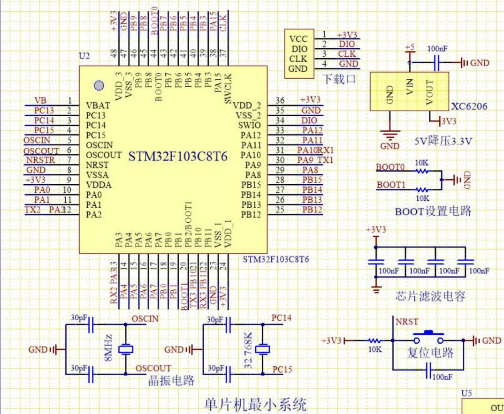
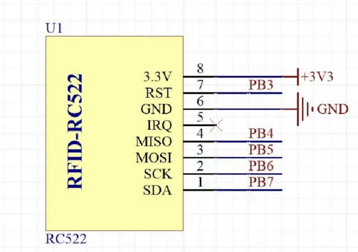
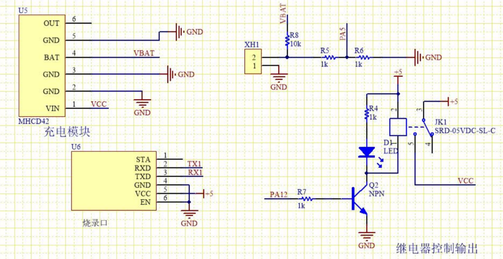
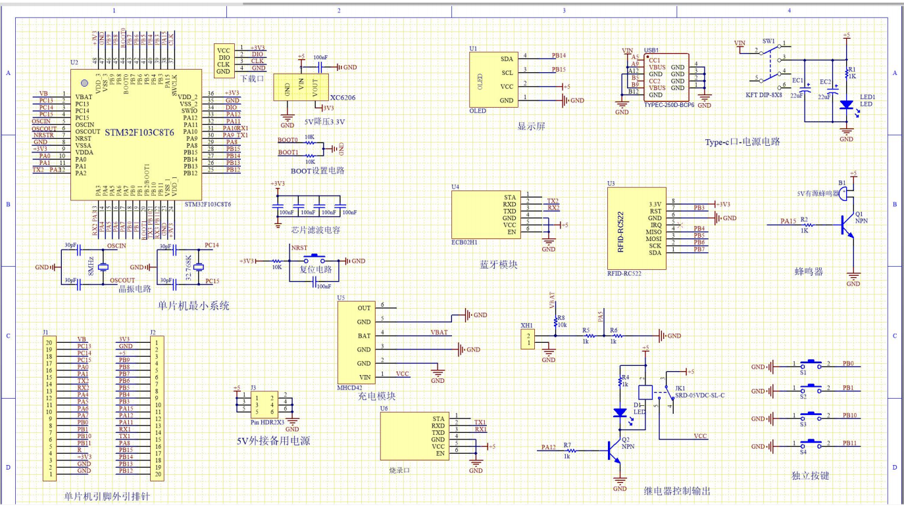
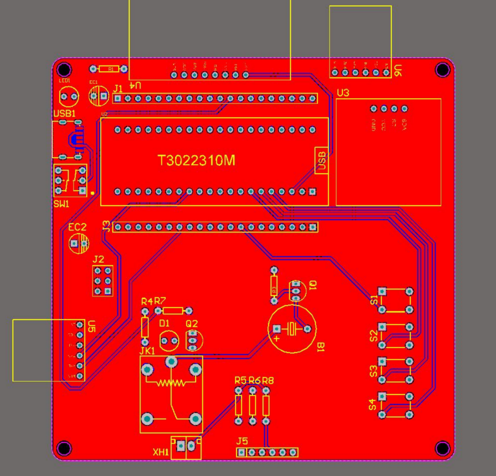
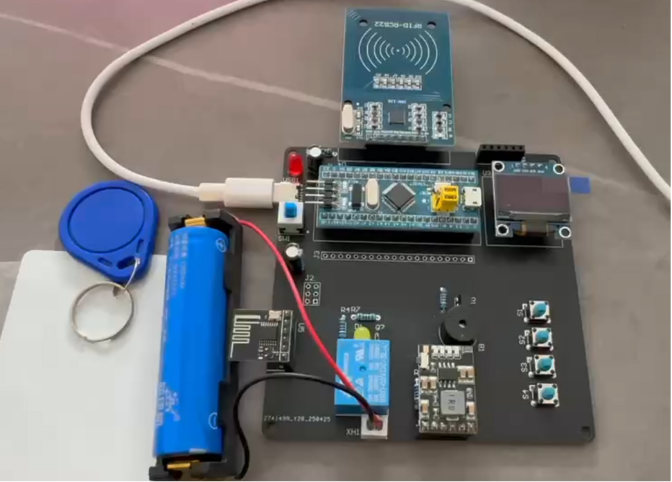

# RFID充电桩控制系统｜硬件说明文档
## 硬件总览
本自助充电桩硬件以STM32F103C8T6为主控，外围包含RFID读卡模块、显示、功率充放电回路、采集、蓝牙通信、声光提示单元，实现刷卡鉴权、计费充电的完整硬件闭环。

## 1. 器件选型
### 1.1 MCU主控选型对比
| 方案 | 主控型号 | 优势 | 缺点 |
| ---- | -------- | ---- | ---- |
| A | STC89C52 | 入门资料多、成本低 | 主频低，定时器/外设资源不足，多传感器扩展受限 |
| B | Arduino UNO | 开发上手简单 | IO驱动弱，主频低，扩展与成本不理想 |
| C | STM32F103C8T6 | Cortex‑M3内核72MHz，多路定时器、串口，GPIO充足，性价比高 | 学习门槛高于51单片机 |

**最终选型：STM32F103C8T6**，搭配扩展底板，集成电源稳压、IO引出、滤波、IIC接口，简化外围电路。

### 1.2 完整硬件BOM清单
|器件|型号|作用|通信接口|
|---|---|---|---|
|主控MCU|STM32F103C8T6|系统业务调度、采集、控制、通信|‑|
|RFID读写模块|MF‑RC522|Mifare‑S50卡刷卡、余额读写鉴权|SPI|
|显示屏|0.96寸 OLED|电压电流、余额、充电状态本地显示|I2C|
|蓝牙透传模块|BLE串口模块|上报状态，接收上位机指令|USART2|
|电压电流采集|分压电阻+采样电阻|电池电参ADC采集|ADC|
|充放电功率单元|锂电池充放电模块|恒压恒流充电、放电保护，继电器通断充电回路|GPIO继电器控制|
|温度传感器（预留）|DS18B20|电池过温保护扩展|单总线|
|人机输入|独立按键阵列|界面切换、参数配置、充值操作|GPIO|
|声光提示|蜂鸣器|异常告警、操作提示|GPIO|
|语音模块（预留）|语音播报模块|状态语音播报|USART1|

## 2. 各模块硬件说明
### 2.1 RC522‑RFID读卡模块
采用NXP MF‑RC522读写芯片，13.56MHz，兼容ISO/IEC 14443 Type‑A、Mifare‑S50卡，支持CRYPTO1加密扇区密码认证。

- 硬件接线：SDA、SCK、MOSI、MISO、RST接STM32 GPIO；VCC接**3.3V**，GND共地。
- PCB布局约束：天线区域远离继电器、功率电感等强干扰器件，天线下方禁止铺铜，避免读卡距离衰减。
- 业务流程：寻卡 → 防冲突 → 选卡 → 扇区密码认证 → 读/写卡片块，完成余额读取、充值、扣费回写。

### 2.2 充放电与功率控制模块
充放电模块为功率执行单元，负责锂电池充放电管理。
1. **充电管理**：外部电源输入，充电IC恒压恒流输出；ADC采集电池电压电流。
2. **放电管理**：内置电路，防止电芯过放损坏。
3. **硬件保护**：模块自带短路、过流、过压、欠压保护；预留DS18B20温度检测接口。
4. **控制逻辑**：STM32 GPIO驱动继电器，根据计费计时状态控制充电回路通断，软件层面增加超时切断保护。

### 2.3 电源系统
- 外部输入直流电源；板载稳压电路输出`3.3V`、`5V`，给MCU、外设模块供电。
- 功率回路与信号回路分开走线，功率地、信号地单点共地，降低功率器件对ADC、RFID射频的干扰。

## 3. PCB设计要点
使用嘉立创EDA绘制原理图与PCB；双层板，尺寸`100mm × 80mm`，板厚1.6mm，铜厚1oz。

布局布线规则：
1. **强弱电分区**：继电器、充放电功率器件放在板子右侧靠近电源端子；单片机、射频RC522放在左侧数字区域。
2. 功率电源线宽≥1.5mm；
3. ADC模拟采样信号线做包地处理；晶振靠近主控，包地，降低噪声。
4. RC522天线区域禁止铺铜，远离继电器、电感，防止射频灵敏度下降。
5. 数字地与模拟地单点汇接铺铜。

## 4. 焊接、调试流程
### 4.1 焊接顺序
1. 先焊接贴片器件，后插件器件；
2. 先焊接低压数字电路，后焊接功率回路；
3. 上电前万用表校验3.3V、5V输出电压，防止电源短路烧毁器件。

### 4.2 分模块调试顺序
1. LED、OLED屏幕基础驱动测试；
2. 按键、蜂鸣器等人机外设调试；
3. RC522寻卡、读卡、写卡功能调试；
4. 继电器输出、ADC电压电流采集校准；
5. 蓝牙通信、整机计费业务联调。

## 5. 硬件踩坑记录
1. **RC522读卡距离衰减**：天线靠近继电器、电源电感，射频被干扰。解决：PCB布局远离功率器件，天线区域禁止铺铜。
2. **ADC采样数值抖动**：电压、电流采样跳动。解决：硬件增加滤波，软件多次采样取平均值滤波。
