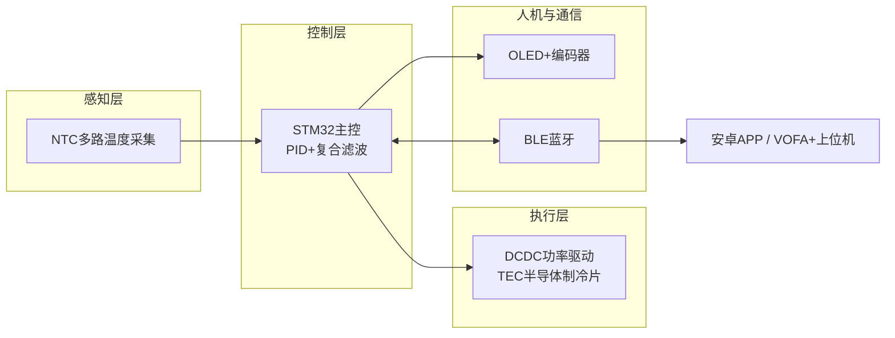
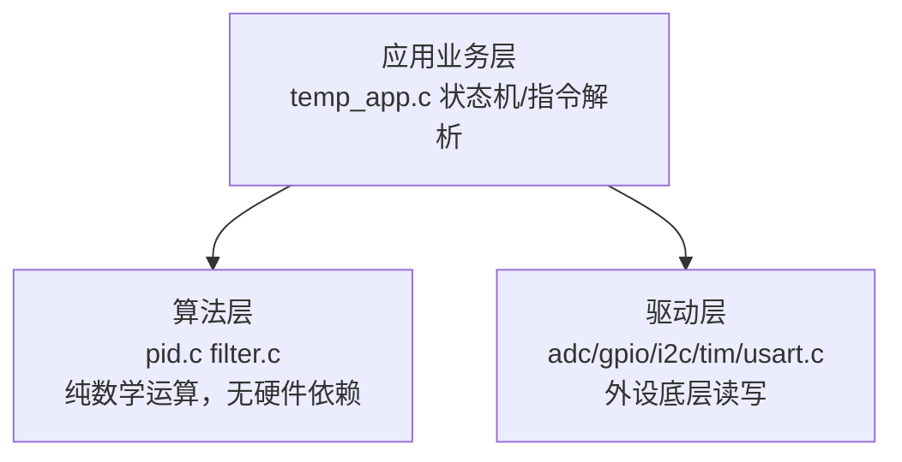
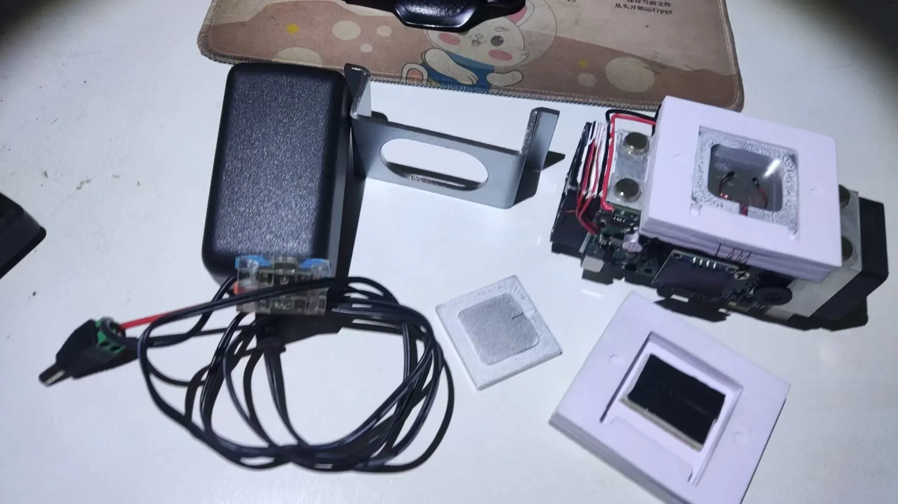
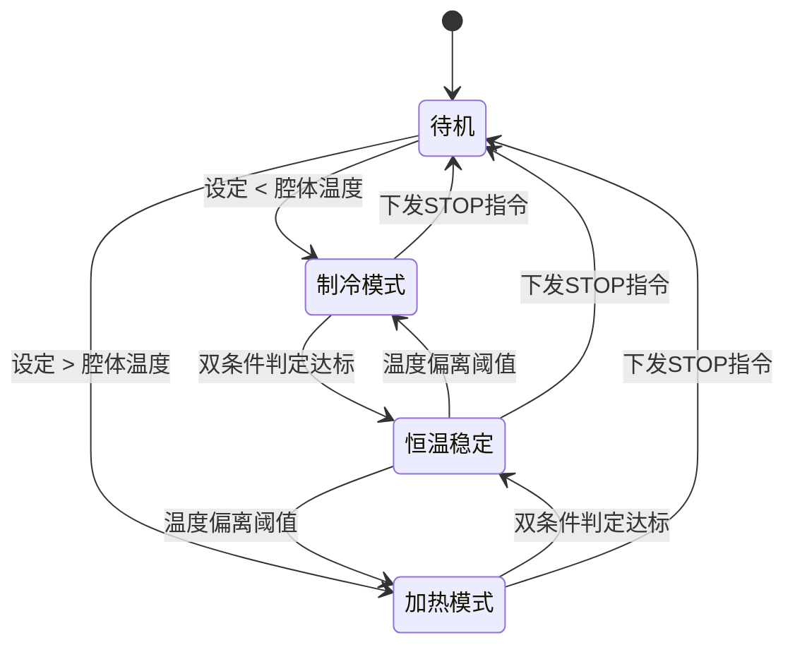
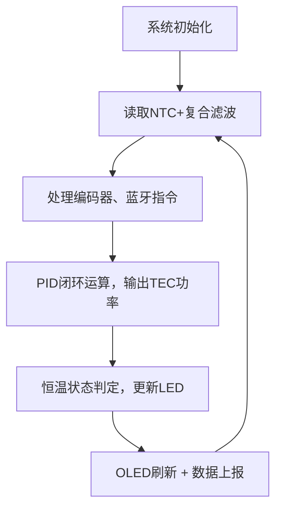
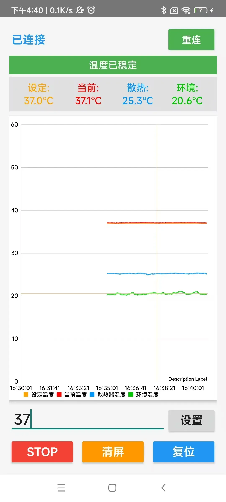
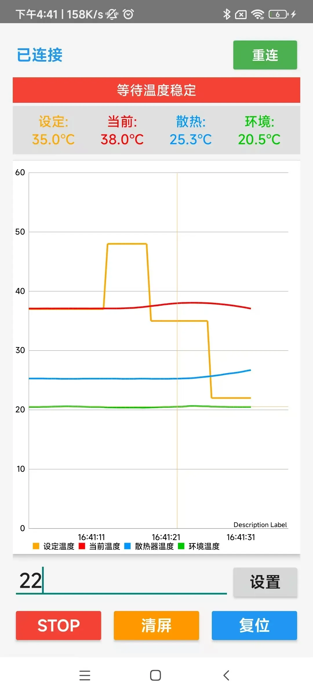

# STM32冷热双循环控制系统 · 详细设计文档
> 项目名称：STM32冷热双循环控制系统
> 主控：STM32L031G6UX MCU
> 应用场景：元器件温漂自动化测试；搭建小型可控恒温腔体，支持制冷、加热双向调节
## 1. 项目概述
### 1.1 项目目标
基于TEC半导体制冷片实现双向精密恒温控制。搭建隔热小型恒温腔体，既可以制冷到**低于环境温度**，也可以加热到**高于环境温度**。
实现多路温度采集、PID闭环温控；支持**本地人机、蓝牙安卓APP、VOFA+上位机**三种交互途径，面向元器件温漂自动化测试场景。



### 1.2 主要技术指标

表格

| 参数 | 指标 |
| --- | --- |
| 控温范围 | 0 ~ 52 ℃（软件 + 硬件双重保护，防止 TEC 器件烧毁） |
| 控制精度 | 优于 ±0.25℃；腔体内温度梯度＜0.5℃ |
| 腔体尺寸 | 20×20×6 mm |
| 恒温判定条件 | 温度误差＜0.25℃ **且** 温度变化率＜0.08℃/s |
| 供电输入 | DC 9‑15V，推荐 12V 3A 电源适配器 |
| 对外交互接口 | OLED + 旋转编码器（本地）；BLE 蓝牙；VOFA + 串口波形输出 |

> 
> ⚠️ 性能边界说明
> 
> 
> 1. 常规设定点：典型稳定时间约 **3 分钟**
> 2. 设定温度靠近散热片温度 ±3℃区间，受 TEC 热耦合效应影响，完全稳定最长约 **10 分钟**

### 1.3 软件分层架构

采用**三层逻辑分层设计**，算法与硬件驱动解耦，便于后期移植到 GD32 平台。

> 
> 工程沿用 CubeMX 原生 Core 目录结构，不新增独立子文件夹，在 Core 内按职责划分代码模块


```
Core/
├── adc.c/gpio.c/i2c.c/tim.c/usart.c  # 驱动层：外设底层读写，NTC、OLED、编码器、蓝牙、DCDC功率驱动
├── pid.c / filter.c                  # 算法层：纯计算逻辑，PID闭环、数字滤波，无硬件依赖
├── temp_app.c                        # 应用业务层：温控状态机、蓝牙指令解析、数据上报、恒温逻辑判断
└── main.c                            # 程序入口：系统初始化、主循环调度
```

- **算法层**：硬件无关，实现 PID 闭环、滑动平均复合滤波算法，抑制 NTC 采样噪声，代码可直接迁移至其他 MCU 平台
- **驱动层**：CubeMX 自动生成外设代码，负责所有外设底层操作：温度采样、屏幕显示、编码器读取、蓝牙收发、TEC 功率控制；仅对外提供访问接口，不包含业务逻辑
- **应用层**：业务状态流转；解析蓝牙指令；判断恒温状态；向上位机、APP 上报温度数据，调用驱动层与算法层接口完成业务

### 1.4 软件工程说明
开发环境：`STM32CubeMX + Keil‑MDK`

- CubeMX 配置文件：`keil_project/OLED.ioc`，可直接打开查看引脚分配、时钟树、外设配置
- 代码划分：`Core`存放自研业务逻辑，`Drivers`为 HAL 底层驱动库（**不修改库源码**）
- 移植特性：PID、滤波、温控状态机等业务逻辑完全硬件无关；向 GD32 迁移仅需要替换底层库、修改时钟初始化，上层应用无需改动。

> 仓库已通过 gitignore 过滤编译产物，下载源码后需要重新编译生成固件。

## 2. 硬件设计
硬件资源统一存放于`hardware/`目录：
- 硬件整体说明、器件清单、PCB / 电源设计：[hardware/hardware.md](./hardware/hardware.md)
- PCB 源文件：[hardware/pcb/](./hardware/pcb/)
- CNC 腔体、钣金 3D STEP 机械模型：[hardware/mechanical/](./hardware/mechanical/)
- 辅助设计资料（TEC 功率核算表、BOM表格、蓝牙模块规格书、采购清单、调试笔记）：[hardware/datasheet/](./hardware/datasheet/)




### 2.1 硬件清单
> 完整器件清单参考：[hardware /datasheet/bom.csv](./hardware/datasheet/bom.csv)
> | 类别 | 器件 | 功能 |
> |----|----|----|
> | 主控 | STM32L031G6UX MCU | 系统调度、ADC 采集、PWM 控制、通信处理 |
> | 执行器件 | TEC 半导体制冷片 | 双向制冷 / 加热 |
> | 温度采集 | 多路 NTC 热敏电阻 | 采集腔体内部温度、散热片温度、环境温度 |
> | 人机交互 | 0.96 寸 OLED + EC11 旋转编码器 + 状态 LED | 参数设置、状态显示；LED 区分制冷 / 加热 / 恒温完成状态 |
> | 无线通信 | BLE 蓝牙模块 | 对接安卓 APP，下发指令、上传温度数据 |
> | 功率电源 | DCDC 功率变换、双级低噪声 LDO、π 型滤波、TVS | 为 TEC 提供大功率驱动；抑制开关电源噪声，输入过压防护 |
> | 机械结构 | CNC 隔热腔体 + 散热风扇组件 | 密闭恒温腔；为 TEC 热面强制散热 |

### 2.2 系统信号链路

1. **温度采集链路**
`NTC热敏电阻 → MCU ADC采样 → 软件数字滤波 → 输出三路有效温度`
2. **功率控制链路**
`MCU控制信号 → DCDC功率变换 → TEC半导体制冷片，实现制冷/加热切换与功率调节`
3. **本地人机链路**
`旋转编码器输入 → 更新目标温度；OLED显示电压、电流、各路温度；LED指示设备工作状态`
4. **蓝牙通信链路**
`MCU ↔ BLE蓝牙 ↔ 安卓APP / VOFA+上位机`，实现指令下发、温度波形数据上传

### 2.3 硬件关键设计要点

1. **电源噪声抑制**
早期版本 LDO 缺少输出电容，温度采样噪声大。新版增加 LDO 输出电容、输入 π 型滤波网络，搭配超低噪声 LDO，降低开关电源带来的 ADC 采样干扰。
2. **地平面处理**
功率地、信号地分区布局，**单点共地**，防止 TEC 大电流功率回路干扰温度 ADC 采样。
3. **输入保护**
增加 TVS 做输入过压防护，严禁接入 24V 电源，供电范围限定 9‑15V。
4. **TEC 热设计（重要）**
散热风扇必须可靠工作；TEC 热面散热失效会直接烧毁半导体制冷片。

## 3. 软件详细设计

### 3.1 算法模块

1. **复合数字滤波**

> 
> 现象：仅使用滑动平均滤波，拔掉 ST‑LINK 调试器后，温度噪声峰峰值会由 0.02℃恶化至 0.1℃。
> 方案：滑动平均滤波叠加二级滤波算法，抑制电源与移除调试器带来的采样噪声。

2. **双向 PID 闭环温控**
针对 TEC 冷热双向对象做闭环控制。TEC 存在固有的热耦合现象：加热与制冷工况模型不一致，当设定温度接近散热片温度时，系统收敛速度明显变慢。


### 3.2 底层驱动模块

- NTC 驱动：多路 ADC 采集 NTC 分压，换算得到实际温度
- OLED 驱动：显示设定温度、腔体、散热片、环境温度、输入电压、功率、电流
- 编码器驱动：EC11 旋转编码器，本地修改目标温度
- 蓝牙串口驱动：串口收发蓝牙数据，适配 VOFA+ JustFloat 协议，上报数据流
- DCDC 功率驱动：控制 TEC 输出功率，切换制冷 / 加热方向

### 3.3 业务层模块

温控状态流转：`待机 → 制冷模式 → 加热模式 → 恒温稳定`



1. **本地控制**
旋转编码器修改目标温度，按下编码器确认启动温控；备用按键执行停止。
1. **蓝牙指令协议**

表格

| 指令 | 功能示例 |
| --- | --- |
| `SETXXTMP` | `SET24TMP` 设置目标温度 24℃ |
| `STOP` | 停止 TEC 温控输出 |
3. **恒温状态判断**
同时校验**温度误差**与**温度变化速率**两个条件；满足条件点亮绿色恒温指示灯，并向上位机、APP 上报恒温完成。
4. **周期数据上报**
定时上报设定温度、腔体温度、散热片温度、环境温度，供给 APP 与 VOFA + 绘制实时曲线。

### 3.4 主程序运行流程


## 4. 测试与踩坑复盘

### 4.1 整机测试方案

1. **单板功能测试**：NTC 采样校准，OLED、编码器、蓝牙通信功能验证
2. **阶跃温控测试**：选取 0℃、11℃、30℃、41℃、42℃、50℃多个测试点，VOFA + 完整记录温度响应曲线
3. **人机联调测试**：本地编码器控温；安卓 APP 下发参数启停，验证波形绘制功能

<p align="center">


<br>手机APP温度曲线监控界面
</p>


### 4.2 问题现象与解决方案

表格

| 问题现象 | 根因 | 解决方案 |
| --- | --- | --- |
| 拔掉 ST‑LINK 调试器，温度采样噪声显著变大 | 单纯滑动平均滤波不足以抑制电源噪声 | 叠加二级数字滤波，降低采样噪声 |
| 温度采样数值随机跳动 | 早期 PCB LDO 缺少输出电容，开关电源噪声串入 ADC | 增加 LDO 输出电容、输入 π 型滤波，使用低噪声 LDO 电源 |
| 靠近散热片温度时，恒温收敛非常慢 | TEC 器件固有热耦合特性 | 文档标注性能边界，用户知晓该工况需要更长稳定时间 |
| TEC 存在烧毁风险 | 热面散热失效、超温工作 | 软件限制最高设定温度 52℃；硬件保证风扇可靠散热 |
| 恒温状态误报，短暂达标就判定恒温完成 | 仅依靠温度误差单条件判断 | 增加温度变化率作为第二判断条件，双条件同时满足才判定恒温稳定 |

## 5. 当前局限 & 后续预研优化方向

### 5.1 现有项目不足

1. 通信仅支持 BLE 蓝牙，无工业 RS485 接口，不支持工业总线组网
2. PID 参数为离线调试固定值；腔体、散热条件改变后需要人工重新整定
3. 缺少故障检测：无风扇故障、TEC 异常识别与保护逻辑

### 5.2 后续预研优化（GD32 迁移与功能扩展）

1. **国产 MCU 迁移：GD32F103RCT6（LQFP‑64）**
   - 硬件兼容：PIN‑to‑PIN 兼容原 STM32 硬件，外围电路无需改动
   - 芯片资源：256KB Flash / 48KB SRAM，5 路 USART；主频最高 108MHz，提升浮点运算性能
   - 串口分配：USART1→BLE 蓝牙；USART2→RS485 Modbus‑RTU；USART3 预留调试口
   - 内存评估：增加模糊 PID、Modbus‑RTU、参数掉电存储后 Flash 余量充足；日志使用**2‑4KB 环形循环缓存**，禁止开辟超大缓冲区防止内存溢出
   - 备选升级：GD32F103RET6（512KB Flash /96KB SRAM），内存翻倍，适合后续持续迭代
   - 迁移改动：替换 GD32 外设库、修改 RCC 时钟与 Flash 等待周期；上层算法业务代码完全复用
   - 参数存储方案：可选①片内 Flash 模拟 EEPROM（增加磨损均衡）；②外接 AT24C02 I2C‑EEPROM。⚠️高频日志**禁止写入片内 Flash**，通过通信上传上位机保存。
2. 硬件增加 RS485，软件实现 Modbus‑RTU 从站，对接 PLC、工业触摸屏
3. 引入模糊 PID，实现 PID 参数自整定，适配不同散热与腔体工况
4. 增加风扇转速检测故障保护，风扇异常时切断 TEC 功率输出
5. 参数掉电存储：保存 PID 整定参数、用户常用设定温度；使用环形日志缓存记录运行状态

## 6. 实物与测试资料存放位置
- 实物照片、VOFA 温控波形截图、安卓 APP 界面：[docs/images/](./docs/images/)
- 整机测试记录：[docs/test_report.md](./docs/test_report.md)
- 硬件设计资料、原理图、PCB、TEC 功率核算工具：存放在[hardware/](./hardware/)对应子目录

> 上位机完整操作步骤见：[上位机使用手册](./docs/upper_manual.md)


## 📌返回导航

[⬅ 返回作品集首页](../../README.md)