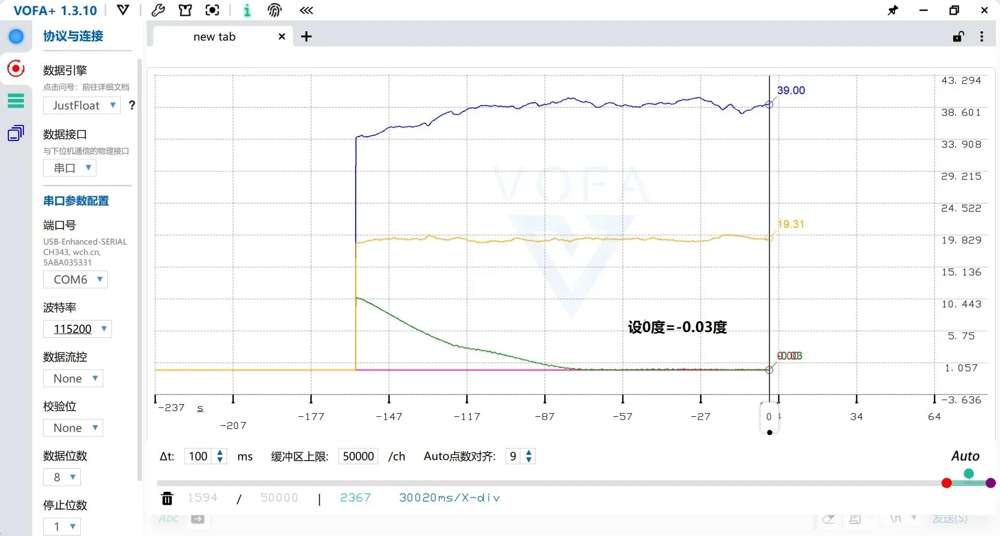
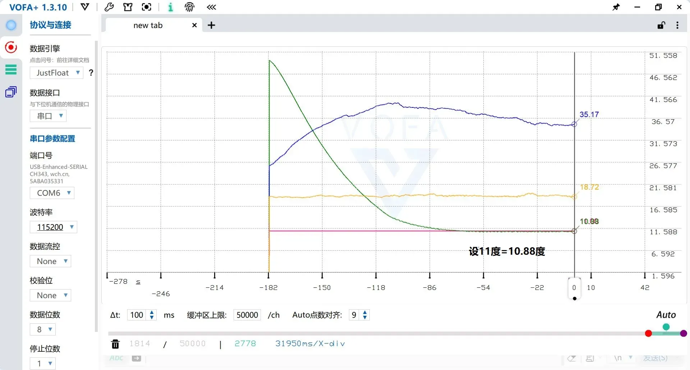
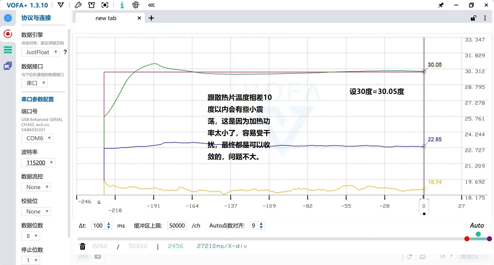
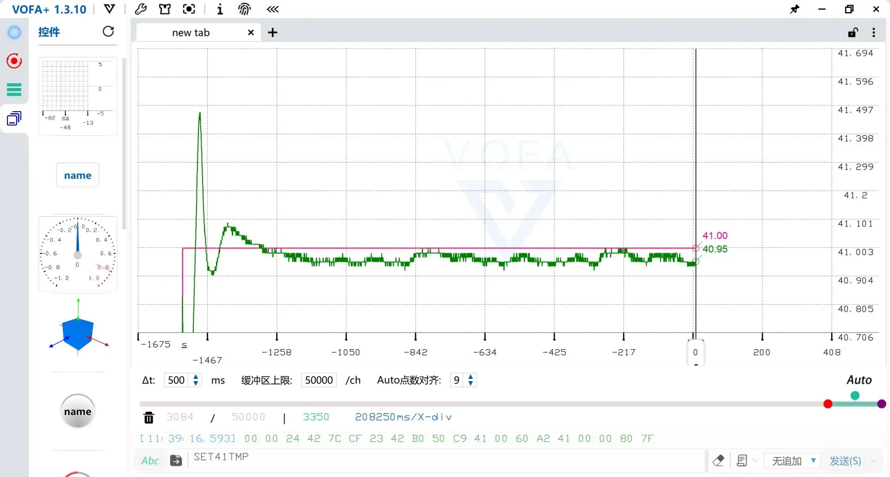
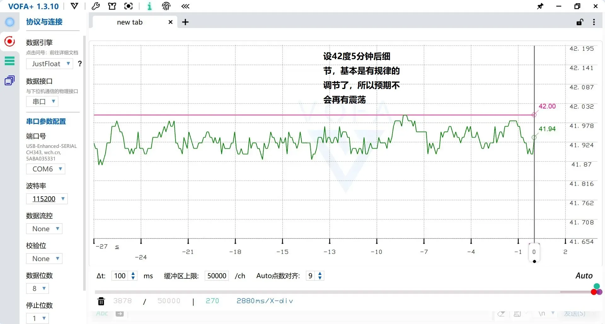
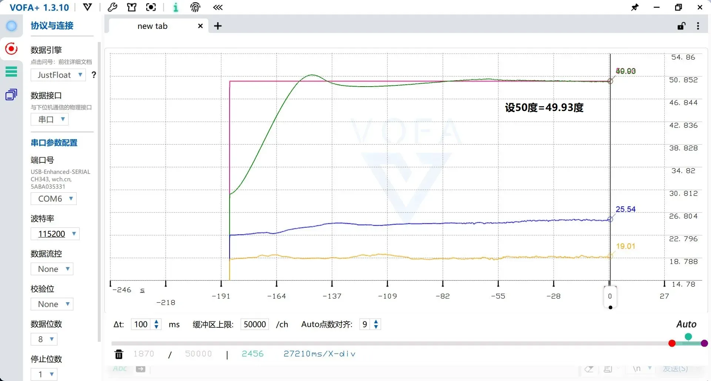
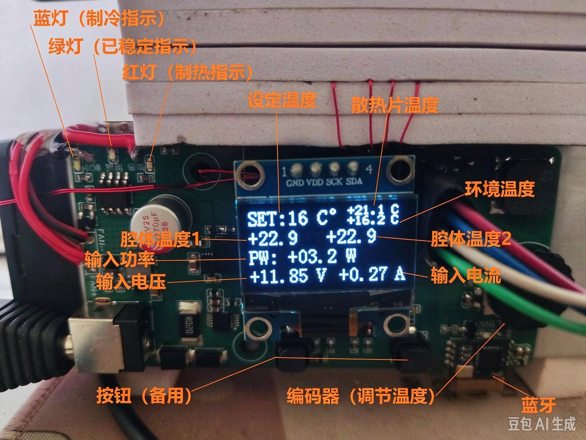

# TEC冷热双循环温控系统 — 整机测试报告
测试版本：V1.1
测试时间：2026‑03‑07
测试硬件：STM32L031G6UX主控板 + TEC半导体制冷片 + CNC隔热腔体
测试环境：室内常温环境
供电条件：DC 12V 3A电源适配器

## 1 测试说明
### 1.1 判定标准
**恒温稳定双条件必须同时满足：**
1. 腔体温度与设定目标温度误差 ＜ ±0.25 ℃
2. 温度变化率 ＜ 0.08 ℃/s

满足条件后硬件绿色LED点亮，同时向上位机/APP上报「恒温完成」状态。

> 性能边界：
> - 普通设定点：典型稳定时间约 **3 min**
> - 设定温度靠近散热片温度 ±3 ℃区间，受TEC热耦合影响，最长稳定时间可达 **10 min**

### 1.2 测试设备
- VOFA+ 1.3.10：记录温度阶跃响应曲线，协议使用 `JustFloat`，波特率115200，上报间隔500ms
- 安卓BLE APP：蓝牙下发指令、观测实时波形
- 12V‑3A直流电源
- 被测硬件整机（腔体、散热风扇、多路NTC温度采集）

### 1.3 控制指令
|指令|功能|
|---|---|
|`SETXXTMP`|设置目标温度，例：`SET24TMP` 设置24℃|
|`STOP`|停止TEC功率输出，退出温控|

## 2 单板硬件功能测试
> 目的：验证基础外设功能正常，再做整机闭环温控测试

|测试项目|测试内容|测试结果|
|---|---|---|
|NTC温度采集|腔体、散热片、环境三路NTC采样读取|✅ 采集正常|
|OLED显示|显示设定温度、腔体、散热片、环境温度、电压、电流、功率|✅ 显示正常|
|EC11编码器|旋转修改目标温度，按下确认启动温控，备用按键STOP停止|✅ 输入响应正常|
|状态LED|蓝灯制冷、红灯加热、绿灯恒温稳定指示|✅ 指示灯逻辑正常|
|BLE蓝牙通信|安卓APP、VOFA+上位机收发指令、接收数据流|✅ 通信正常|

> 重要现象：
> 仅开启滑动平均滤波时，**拔掉ST‑LINK调试器后温度噪声峰峰值由0.02℃恶化至0.1℃**；
> 增加二级复合数字滤波后，噪声得到抑制。

## 3 整机阶跃温控测试
> 测试点：0℃、11℃、30℃、41℃、42℃、50℃
> 说明：红色曲线‑设定温度；绿色‑腔体温度；黄色‑环境温度；蓝色‑散热片温度

|设定目标温度|现象简述|测试结果|波形文件|
|---|---|---|---|
|0 ℃|制冷工况，腔体降温至接近0℃；TEC热面散热风扇持续工作|✅ 可以达到目标，稳定时间较长|`images/vofa_0deg.png`|
|11 ℃|制冷工况，远离散热片温度，收敛速度较快|✅ 满足恒温判定条件|`images/vofa_11deg.png`|
|30 ℃|加热工况；和散热片温度接近，存在小幅震荡，最终收敛稳定|✅ 满足恒温判定条件|`images/vofa_30deg.png`|
|41 ℃|加热工况；长时间运行20min，观察稳态震荡|✅ 稳态存在微小波动，满足指标|`images/vofa_41deg.png`|
|42 ℃|加热工况，5min后进入精细调节，小幅周期性震荡，可收敛|✅ 满足恒温判定条件|`images/vofa_42deg.png`|
|50 ℃|高温加热工况，软件限制最高温度52℃做器件保护|✅ 可以达到设定温度|`images/vofa_50deg.png`|

### 测试波形截图

> 测试备注：
> 当设定温度与散热片温度差值在 ±3℃以内，受TEC热耦合固有特性影响，系统震荡会增大，需要更长时间收敛，属于器件固有现象。
> 
> 红色曲线：设定温度
>
>  绿色曲线：腔体内空气的温度
>
>黄色曲线：环境温度
> 
> 蓝色曲线：散热片温度

## 4 人机联调测试
1. **本地操作测试**：编码器设置温度，按键启停；OLED实时刷新参数，LED状态跟随工况切换。✅正常
2. **安卓APP蓝牙测试**：蓝牙连接，下发SET指令设置温度、STOP停止；APP绘制温度曲线，接收恒温完成状态提示。✅正常
3. **VOFA+电脑上位机测试**：蓝牙串口透传，JustFloat协议，多路温度波形实时绘制。✅正常

### 设备实拍

### 安卓APP界面

## 5 已知硬件&软件问题
1. PCB改版优化电源（增加LDO就近输出电容、π型滤波、增加低噪声LDO）仅完成画板，**暂未实机验证**，理论可以进一步降低ADC温度采样跳动。
2. 只完成上述6个温度点测试，其余温度档位未完整遍历测试。
3. 靠近散热片±3℃工况，控制动态性能会劣化，收敛时间变长，为TEC器件热耦合固有特性。
4. 当前版本无风扇转速检测、TEC故障识别保护逻辑，属于后续预研优化项。

## 6 测试相关素材索引
- VOFA+阶跃波形截图、整机实物照片、OLED屏幕实拍、APP界面截图：`./images/`
- TEC功率核算工具：`../hardware/datasheet/TEC电源功率核算.xlsx`

## 7 后续验证建议
1. 对新版电源PCB进行实机测试，验证采样噪声改善效果。
2. 补充更多中间温度点的阶跃测试。
3. 增加长时间老化稳定性测试。

> 上位机详细配置教程参考：[上位机使用手册](./upper_manual.md)

## 📌返回导航
[⬅ 返回作品集首页](../../../README.md)