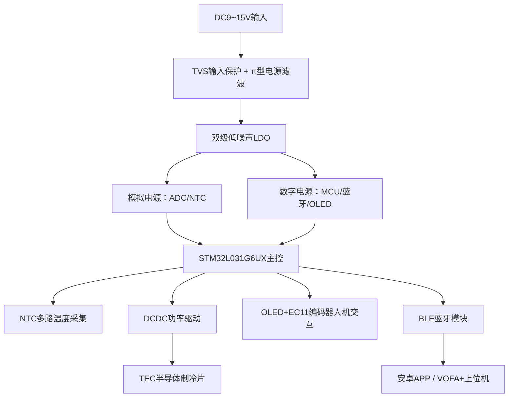
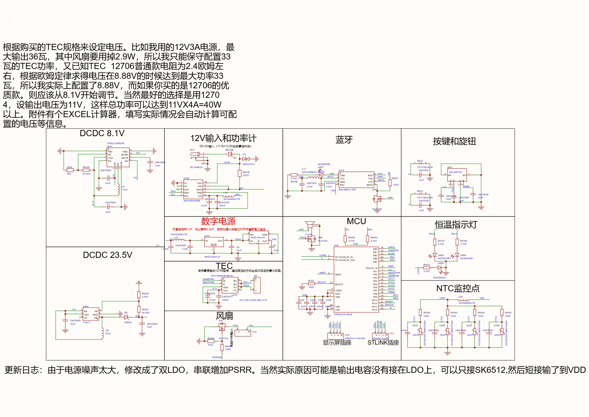
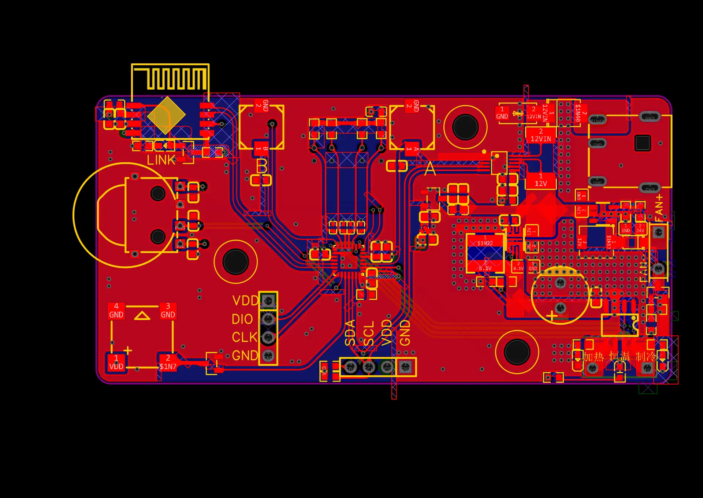

# 硬件设计说明
## 概述
本硬件为TEC半导体制冷双向恒温控制器，基于STM32L031G6UX，搭建0‑52℃小腔体双向恒温系统，面向元器件温漂自动化测试场景。
硬件包含主控单元、多路温度采集单元、TEC功率驱动单元、人机交互、BLE蓝牙通信、电源滤波网络、CNC隔热机械腔体。

> ⚠️ **供电说明**：DC 9‑15V，**禁止接入24V电源**。

## 1. 器件清单

| 类别 | 器件 | 功能说明 |
| --- | --- | --- |
| 主控 | STM32L031G6UX MCU | 系统调度、ADC 温度采集、PWM 功率控制、外设通信处理 |
| 执行器件 | TEC 半导体制冷片 | 实现制冷、加热双向控温，电流方向决定冷热模式 |
| 温度采集 | 多路 NTC 热敏电阻 | 分别采集：腔体内部温度、散热片温度、环境温度 |
| 人机交互 | 0.96 寸 OLED、EC11 旋转编码器、三色状态 LED | 设置温度、运行状态显示；LED 分别指示制冷、加热、恒温稳定 |
| 无线通信 | BLE 蓝牙模块 | 和安卓 APP、电脑蓝牙上位机通信，下发指令，上传温度数据流 |
| 功率电路 | DCDC 功率变换电路 | 为 TEC 半导体制冷片提供大功率可调输出，控制功率与冷热方向 |
| 模拟电源 | 双级低噪声 LDO + π 型滤波网络 | 给 MCU、ADC 模拟部分供电，抑制开关电源噪声，降低温度采样抖动 |
| 保护器件 | TVS 管 | 电源输入过压防护 |
| 机械配套 | CNC 隔热腔体、散热风扇、钣金磁吸盖板 | 构建密闭小恒温腔；对 TEC 热面强制散热 |

> 
> 采购成本测算参考：[datasheet/最小量购买价格表.xlsx](./datasheet/%E6%9C%80%E5%B0%8F%E9%87%8F%E8%B4%AD%E4%B9%B0%E4%BB%B7%E6%A0%BC%E8%A1%A8.xlsx)

### 1.1 BOM 物料清单（立创商城 · 核心物料节选）

> 
> 完整 BOM CSV 文件存放于 [/datasheet/bom.csv](./datasheet/bom.csv)，可直接导入立创 EDA

| ID | Name | Designator | Footprint | Quantity | Manufacturer Part | Manufacturer | Supplier | Supplier Part |
| --- | --- | --- | --- | --- | --- | --- | --- | --- |
| 1 | 4.7kΩ | R4198,R4197,R4211,R4196,R4253,R4254 | R0603 | 6 | 0603WAF4701T5E | UNI-ROYAL(厚声) | LCSC | C23162 |
| 2 | NCD0603B1 | LED4,LED7 | LED0603-RD | 2 | NCD0603B1 | 国星光电 | LCSC | C84266 |
| 3 | 470uF | C6075578 | CAP-TH_BD8.0-P3.50-D0.6-FD | 1 | RV471M250F070R1Z00ZZ | 创慧电子 | LCSC | C51026670 |
| 4 | 10kΩ | R4224,R4245,R4246,R4247 | R0603 | 4 | 0603WAF1002T5E | UNI-ROYAL(厚声) | LCSC | C25804 |
| 5 | MT52B103F3950F01000 | U235,U236,U237,U238 | RES-TH_BD2.0-P1.80-D0.3 | 4 | MT52B103F3950F01000 | STE(松田) | LCSC | C3000141 |

## 2. 硬件整体框图简述

硬件划分为4大功能模块：

1. **模拟采集模块**：多路 NTC 分压电路，接入 MCU ADC，采集三路温度信号。
2. **主控与通信模块**：STM32主控 + BLE蓝牙，负责逻辑运算、人机交互、数据上报。
3. **功率驱动模块**：DCDC功率回路，驱动TEC半导体制冷片，实现制冷/加热切换与功率调节。
4. **电源模块**：外部12V适配器输入，经过TVS防护、π型滤波，双LDO输出干净的模拟/数字电源。

### 信号流向

1. 温度信号：NTC 分压 → MCU ADC 采样 → 软件复合滤波得到温度值
2. 功率控制：MCU 控制信号 → DCDC 功率变换 → TEC 执行冷热输出
3. 人机交互：编码器输入设定温度，OLED 展示电压、电流、各路温度；LED 指示工作状态
4. 通信链路：MCU ↔ BLE 蓝牙 ↔ APP / VOFA+上位机，双向收发指令与波形数据

## 3. 电源设计要点

1. **外部输入**：推荐12V‑3A直流适配器，允许输入范围9~15V。TVS做输入过压保护，严禁24V输入。
2. **噪声优化（本项目关键踩坑点）**
   - 初版硬件LDO缺少就近输出电容，ADC温度采样噪声大；
   - 改版增加LDO就近去耦电容；电源输入端增加π型滤波网络；增加一级超低噪声LDO给模拟电路供电，抑制开关电源高次谐波干扰。
3. **地处理**：**功率地与信号地分区布局，单点共地**。> 
> TEC属于大电流功率回路，功率地和模拟地混杂会严重污染ADC温度采样，造成温度读数跳动。
4. 功率部分与MCU逻辑部分供电分开，功率走线尽量短粗。

## 4. PCB 设计注意事项

1. NTC模拟采样走线尽量短，远离DCDC功率走线，避免数字/功率噪声串入ADC。
2. LDO的输出电容必须紧贴芯片输出引脚，实现最佳滤波效果。
3. TEC功率回路走线加宽，承受大电流。
4. 功率地、信号地分割，单点汇接。
5. 蓝牙模块远离功率DCDC区域，减少电磁干扰影响蓝牙稳定性。

> 
> PCB源文件存放路径：
> 
> 
> - PCB 文件：[./pcb/](./pcb/)

## 5. 实物展示

## 6. 机械结构说明

恒温腔体采用CNC加工，搭配磁吸钣金盖板，形成隔热密闭小腔。

- 腔体内部有效尺寸：20×20×6 mm，用于放置被测元器件。
- TEC热面必须搭配散热风扇强制散热；**风扇失效会直接烧毁TEC制冷片**。

> 
> 3D模型STEP文件路径：[./mechanical/](./mechanical/)，可使用SolidWorks / FreeCAD打开查看腔体结构。

## 7. 硬件已知局限

1. TEC器件本身存在热耦合效应，当设定温度靠近散热片温度 ±3℃时，系统达到稳定时间会拉长，最长约10分钟。
2. 硬件当前只预留蓝牙通信，无板载RS485电路；若要实现Modbus‑RTU，需要外接RS485收发芯片做硬件扩展。

## 8. 相关辅助工具文档

- TEC 功率选型核算工具：[datasheet/TEC电源功率核算.xlsx](./datasheet/TEC%E7%94%B5%E6%BA%90%E5%8A%9F%E7%8E%87%E6%A0%B8%E7%AE%97.xlsx)
- 蓝牙模块规格、调试说明：[datasheet/](./datasheet/)

## 📌返回导航

[⬅ 返回作品集首页](../../../README.md)