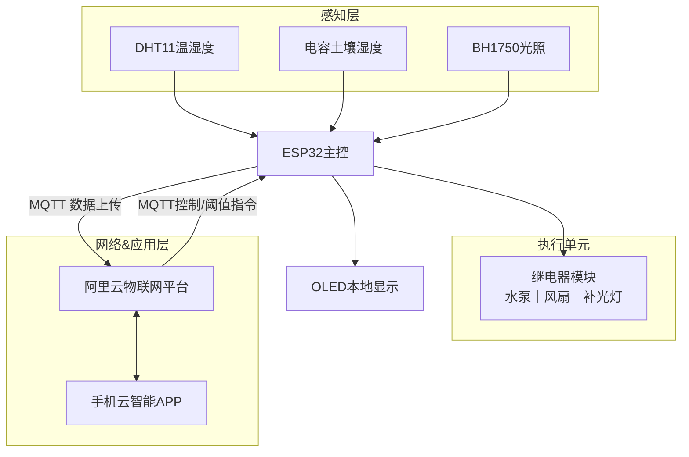

# ESP32 智能温室大棚系统 ⭐⭐
🏷 `ESP32` `MQTT` `阿里云物联网` `传感器采集` `自动阈值控制`
> ✨亮点：物联网三层架构，多环境传感器采集，本地OLED显示；阿里云MQTT云端双向通信，APP远程监控；支持自动/手动模式，阈值滞回防抖，低成本课程设计物联网项目。

## 🧩硬件平台
- 主控：ESP32‑WROOM‑32 双核240MHz，内置WiFi/蓝牙
- 传感器：DHT11温湿度、电容式土壤湿度、BH1750光照传感器
- 显示：0.96寸 I2C‑OLED 本地数据显示
- 执行器：光耦隔离双路继电器，控制水泵、风扇、补光照明
- 通信：2.4G‑WiFi，阿里云生活物联网平台 MQTT协议

## ⚡核心功能
1. 多参数环境采集：温湿度、土壤湿度、光照强度，软件复合滤波抑制采样抖动
2. 本地OLED实时展示采集数据、阈值、设备运行状态
3. **自动/手动双控制模式**：阈值滞回保护，避免继电器频繁误触发
4. 阿里云MQTT双向通信：数据定时上传云端，手机APP下发阈值、设备控制指令
5. 网络异常自动重连，提升物联网设备运行稳定性

## 📦项目依赖库
> 在Arduino IDE库管理器直接搜索名称安装即可
1. ArduinoJson6
2. PubSubClient
3. Crypto（提供 HMAC‑SHA256）
4. DHT sensor library
5. Adafruit Unified Sensor
6. U8g2

## 🔨编译运行
IDE环境：Arduino‑IDE
> ⚠️本仓库**不包含IDE、编译器、第三方库源码**，请自行安装Arduino IDE以及ESP32开发板支持包。
> 🛠️完整部署复现步骤参考：[docs/deploy_guide.md](./docs/deploy_guide.md)

1. 安装ESP32开发板支持包，安装上面全部依赖第三方库
2. 修改WiFi 2.4G账号密码，填入阿里云`ProductKey / DeviceName / DeviceSecret`
3. ⚠️注意：公开仓库请勿提交真实WiFi密码、阿里云三元组密钥，提交前务必替换为占位注释
4. 编译烧录至ESP32开发板；串口波特率115200观察运行日志
5. 阿里云平台创建设备，使用云智能APP完成配网调试

## 🛠遇到的问题与解决方案
1. **WiFi配网失败，无法接入阿里云MQTT**
现象：烧录正常，WiFi连接反复失败，无云端数据上报。
解决：核对WiFi为2.4G频段，校验阿里云三元组密钥；增加WiFi/MQTT断线自动重连逻辑，网络恢复自动重接入平台。

2. **传感器原始采样数据跳动，数值波动大**
现象：温湿度、光照采样出现突变异常值，OLED显示数据抖动。
解决：采用**均值+中值复合滤波**，多次采样剔除极值再输出有效数据，抑制环境电磁干扰带来的噪声。

3. **阈值临界点继电器频繁启停抖动**
现象：环境参数在阈值附近小幅波动，继电器反复吸合断开。
解决：增加**滞回控制逻辑**，区分开启阈值、关闭阈值，增加缓冲区间，加上状态锁存，杜绝频繁误动作。

4. **云端APP下发指令，设备无响应**
现象：设备可以上传数据，但是APP下发控制/修改阈值指令本地不执行。
解决：核对MQTT发布、订阅主题完全一致；增加报文格式校验，非法报文直接丢弃，完善指令解析分支。

## 📁仓库目录说明
```

personal_project_03_esp32_greenhouse/
├── GreenHouse3.ino        # Arduino 主程序入口
├── aliyun_mqtt.cpp        # 阿里云 MQTT 业务实现
├── aliyun_mqtt.h          # MQTT 头文件
├── main.h                 # 全局宏、WiFi / 阿里云三元组配置
├── docs/
│   ├── hardware/          # 硬件原理图、器件清单
│   ├── images/            # 实物照片、原理图、APP 界面截图
│   └── deploy_guide.md    # 项目部署复现操作手册
├── design.md
└── README.md              # 项目简介主页

```

## 📎流程图


## ✨后续优化方向

1. 扩展多 ESP32 分布式多点采集节点；
2. 增加低功耗休眠，电池供电场景适配；
3. 增加本地 SD 卡，环境数据本地落盘存储；
4. 增加超限报警提示。
5.  **引入 Linux 边缘网关（如树莓派）方案**：网关作为本地 MQTT Broker 汇聚多台 ESP32 终端设备，实现局域网内数据闭环，断外网情况下仍可本地管控温室；网关完成原始数据持久化、数据预处理，减少对公有云平台依赖。
6. **边缘 AI 大模型推理预研**：在 Linux 边缘网关部署轻量大模型 / 时序预测模型，基于历史温湿度、土壤、光照数据，完成环境趋势预测、作物生长状态研判，智能动态生成调控阈值，替代固定人工阈值，实现 AI 自主调控；同时支持本地自然语言交互查询温室环境数据。
   
## 📌返回导航

[⬅ 返回作品集首页](../../README.md)

