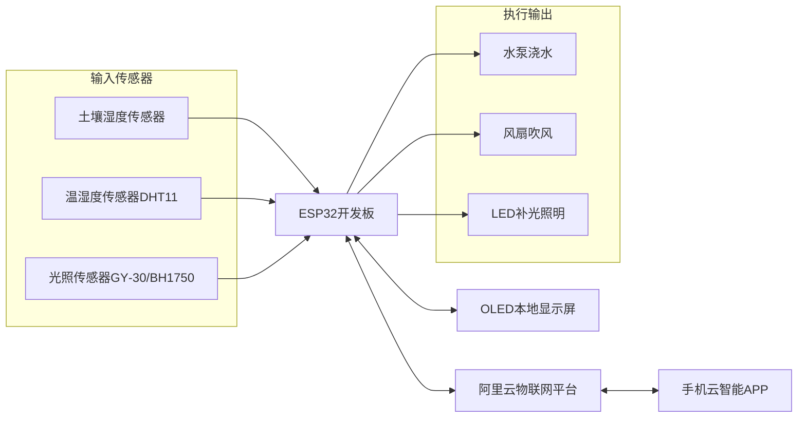

# ESP32智能温室大棚系统｜详细设计文档
## 📋项目概述
针对传统温室人工监测效率低、调控滞后、管理成本高的痛点，基于ESP32 + 阿里云MQTT搭建物联网温室管控系统。
采用**感知层‑网络层‑应用层**标准物联网三层架构，实现多环境传感器采集、本地OLED可视化、阈值自动控制、手机APP远程监控。
硬件整体成本40.9元，适用于小型温室、家庭盆栽种植场景。

**技术指标**
|项目|参数|
|---|---|
|主控|ESP32‑WROOM‑32，双核LX6@240MHz|
|采集参数|温度、湿度、土壤湿度、光照强度|
|传感器采集周期|5s采集1次|
|云端MQTT数据上传周期|30s上传1次|
|通信|2.4G WiFi，MQTT；传输成功率≥99%，通信延迟＜500ms|
|控制模式|自动阈值控制 / APP手动控制；阈值EEPROM断电保存|
|本地显示|0.96寸I2C‑OLED，实时刷新参数与设备状态|
|稳定性|72h连续上电无死机；WiFi/MQTT断线自动重连，重连逻辑不阻塞主循环|

## 🧩硬件总体设计
### 系统架构框图

### 器件清单
|器件|型号|作用|
|---|---|---|
|主控|ESP32‑WROOM‑32|数据采集、业务逻辑运算、WiFi/MQTT通信|
|温湿度传感器|DHT11|空气温度、相对湿度采集|
|土壤湿度传感器|电容式ADC|检测土壤含水量；规避电阻式传感器易腐蚀老化缺陷|
|光照传感器|BH1750(GY‑30)|I2C接口光照强度采集|
|OLED显示屏|0.96寸 I2C 128*64|本地参数、阈值、设备运行状态显示|
|继电器模块|双路5V光耦隔离|驱动水泵、风扇、补光LED功率回路|

> 📋完整器件方案对比、BOM成本、参数详情见：[元器件选型文档](./docs/hardware/components.md)

### 硬件设计要点
1. 继电器采用光耦隔离，实现强弱电隔离，保护ESP32主控IO；
2. DHT11单总线通信，外部增加上拉电阻保障通信稳定性；
3. BH1750与OLED共用一路I2C总线，确认器件I2C地址无冲突；
4. 硬件仅支持**2.4G WiFi，不兼容5G WiFi**；
5. 土壤湿度选用电容式传感器，避免电阻式探头长期埋土腐蚀失效。

## ⚙软件总体架构
软件分层：`底层外设驱动 → 数据采集层 → 业务逻辑层(阈值判断) → MQTT通信层 → 本地显示层`

### 业务完整流程
1. 系统上电初始化：GPIO、I2C、ADC、OLED、EEPROM、WiFi、MQTT客户端；
2. 每5s周期性读取DHT11、BH1750、土壤湿度ADC原始数据；对DHT11做NaN非法数据过滤，直接丢弃异常采样值；
3. OLED刷新页面，展示传感器参数、控制阈值、设备运行状态；
4. **自动模式**：执行阈值判断逻辑，输出电平驱动继电器完成浇水、通风、补光动作；
5. 每30s把环境参数、阈值、设备工作状态通过MQTT报文上报阿里云平台；
6. 监听MQTT下行报文：解析APP下发的控制指令与阈值参数；新阈值写入EEPROM实现断电保存；
7. 主循环持续检测WiFi/MQTT连接状态，断开触发非阻塞自动重连逻辑。

### MQTT阿里云物模型配置说明
1. 阿里云生活物联网平台新建产品，设备类型选择网关；
2. 物模型自定义属性标识符必须与固件完全匹配：
`Temp`温度、`Humi`湿度、`Humi1`土壤湿度、`Light`光照、
`Set_Temp`温度阈值、`Set_Humi`湿度阈值、`Set_Light`光照阈值、
`Set_Mode`控制模式、`Water`浇水、`Led`补光、`Fan`风扇；
3. 获取设备三元组 `ProductKey`、`DeviceName`、`DeviceSecret` 配置进固件；
4. APP人机面板分为：参数显示页面、阈值参数设置页面。

> 重要：MQTT发布Topic、订阅Topic必须与阿里云平台完全一致，否则设备无法接收云端下发指令。

### 关键业务逻辑说明
1. **传感器异常过滤**：DHT11增加NaN非法值判断，异常采样直接丢弃，不参与业务计算；光照、土壤湿度当前版本仅单次采样读取。
2. **阈值控制逻辑**：使用单一阈值判断；参数超限执行开启动作；低于阈值执行关闭动作。
> ⚠️现状：**暂未实现滞回回差逻辑**，参数在阈值临界点小幅抖动时，继电器会频繁启停，为后续优化点。
3. **网络重连机制**：在`loop()`循环内检测连接状态，断开触发重连，重连过程不会阻塞其余业务执行。
4. **自动/手动模式切换**
    - 自动模式：本地传感器+阈值逻辑直接控制继电器；
    - 手动模式：本地阈值判断逻辑关闭，继电器只响应APP下发指令。

## 🧪系统测试方案
### 测试设备
ESP32整机、DHT11、BH1750、电容土壤湿度传感器、继电器执行机构、阿里云云智能APP。

### 测试项目
1. **传感器采集与本地显示测试**
人为改变温湿度、光照、土壤湿度环境，观察OLED参数同步刷新；DHT11产生的NaN异常数据会被过滤丢弃。

2. **自动阈值控制测试**
APP设置各项控制阈值；人为制造参数超限环境，观察继电器对应动作；
> 备注：参数在阈值临界点小幅抖动，会出现继电器频繁启停，需后续增加滞回逻辑优化。

3. **APP手动控制测试**
切换至手动模式，APP下发开关指令，水泵/风扇/补光LED实时响应。

4. **远程阈值修改测试**
APP修改各项控制阈值；参数写入EEPROM，重启设备后阈值不丢失，OLED同步更新显示。

5. **断网重连稳定性测试**
手动断开路由器WiFi，之后恢复网络；设备自动重连阿里云，恢复数据上报与指令接收。

6. **长时间稳定性测试**
72小时连续上电运行，采集、自动控制、云端通信功能正常，无死机卡死。

## ⚠现存局限与后续优化方向
1. 当前为单节点采集系统，可扩展多ESP32组成分布式多点采集网络；
2. 传感器仅DHT11做简单异常丢弃，**尚未实现均值‑中值复合滤波**，易受电磁干扰出现采样跳变；
3. 控制逻辑缺少滞回回差缓冲，临界点继电器频繁启停，需要独立配置开启阈值、关闭阈值，增加状态锁存；
4. 无本地存储，断电历史采集数据丢失；可外接SD卡实现本地日志落盘；
5. 无低功耗休眠，设备持续满功率运行；电池供电场景需要休眠改造；
6. 无实体本地按键，全部配置依赖OLED+APP；后续可增加按键实现本地参数配置。

## 📎关键问题复盘
|现象|根因|解决办法|
|---|---|---|
|WiFi配网失败，无法接入阿里云MQTT|WiFi密码错误、使用5G频段WiFi、阿里云三元组填写错误|使用2.4G WiFi；核对设备三元组；增加WiFi/MQTT非阻塞断线重连逻辑|
|传感器采样数值跳动波动大|环境电磁干扰；仅单次采样，缺少软件滤波|待优化：增加均值+中值复合滤波抑制噪声；当前版本仅DHT11做NaN异常丢弃|
|阈值临界点继电器频繁启停抖动|只有单一阈值，没有滞回回差缓冲逻辑|待优化：区分开启、关闭两套阈值，增加状态锁存；当前版本未实现|
|云端APP下发指令设备无响应|MQTT发布/订阅Topic不匹配；缺少JSON报文合法性校验|固件与阿里云平台Topic保持一致；增加报文解析校验，非法报文直接丢弃|

## 📌返回导航
[⬅ 返回作品集首页](../../README.md)
